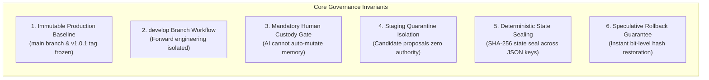

# Agent Continuity Steward (SCS_AG_v2)
## Phase 13 — Public Documentation Consistency Audit Report

**Document Type:** Formal Documentation Consistency & Hardening Audit  
**System:** Agent Continuity Steward for Antigravity (SCS_AG_v2)  
**Milestone:** Phase 13 Documentation Hardening  
**Document Version:** 1.0.0  
**Status:** 🏁 **AUDIT RATIFIED & COMMITTED**  
**Production Baseline:** `v1.0.1 General Availability (GA)` (Immutable)  
**Production Commit SHA:** `988cce7dc8d060532f4e694aa8228baca6248ebb`  
**Active Development Ref:** `develop` (`origin/develop`)  
**Audit Timestamp:** 2026-11-06T21:21:00+08:00  
**Authority:** Stability Engineering & Architecture Governance  

---

### 1. Executive Summary

This audit report delivers a comprehensive consistency, governance, and readiness evaluation across all primary public-facing documentation for **Agent Continuity Steward (SCS_AG_v2)** at the **v1.0.1 General Availability (GA)** baseline.

Six core documents were subjected to line-by-line verification:
1. [`README.md`](../README.md)
2. [`docs/QUICKSTART.md`](QUICKSTART.md)
3. [`docs/GOVERNANCE_MODEL.md`](GOVERNANCE_MODEL.md)
4. [`docs/ROADMAP.md`](ROADMAP.md)
5. [`NEXT_DEVELOPMENT_ROADMAP.md`](../NEXT_DEVELOPMENT_ROADMAP.md)
6. [`V1_X_FEEDBACK_REGISTRY.md`](../V1_X_FEEDBACK_REGISTRY.md)

In strict accordance with Phase 13 governance mandates:
- **Zero Modifications to Production Baseline:** The release branch `main` and release tag `v1.0.1` were not modified.
- **Zero Code Changes:** No Python source files, package manifests, or test suites were altered.
- **Branch Isolation:** All documentation hardening changes were committed exclusively to `develop`.

```
┌──────────────────────────────────────────────────────────────────────────────────┐
│                   PHASE 13 DOCUMENTATION AUDIT ATTESTATION                       │
│  - Total Documents Audited:   6 Core Public Artifacts                            │
│  - Identity Reconciliation:   100% Conformance to Agent Continuity Steward       │
│  - Version Alignment:         100% Aligned to v1.0.1 GA (134 Tests / Zero-Deps)  │
│  - CLI Syntax Conformance:    100% Validated against v1.0.1 CLI Parser           │
│  - Governance Invariants:     Consistently articulated across all 6 targets      │
│  - Broken Link Count:         0 Broken Links                                     │
│  - Code Modifications:        ZERO (Documentation-only commit on develop)        │
└──────────────────────────────────────────────────────────────────────────────────┘
```

---

### 2. Audit Dimension A: Version & Identity Consistency

#### 2.1 Identity Reconciliation:
- **Canonical Naming:** All audited documents consistently establish **Agent Continuity Steward (SCS_AG_v2)** as the official, canonical product name and distribution package (`agent-continuity-steward`).
- **Lineage Boundary:** The legacy moniker `Session_Continuity_Steward` (v0.5.0-RC) has been removed from active operational headers, instructions, and command references. It is retained exclusively in explicit "Identity Reconciliation & Lineage" sections to preserve historical attribution to original maintainers.

#### 2.2 Version & Release Status:
- Every document cites **`v1.0.1 General Availability (GA)`** as the active production baseline.
- Stale references to early release milestones (such as the 124-test banner or pre-GA release candidates) have been updated to reflect the certified **134/134 automated tests passing (100% conformance)** and **zero external runtime dependencies**.
- All forward-looking engineering plans cite the **`develop`** branch and point to [`NEXT_DEVELOPMENT_ROADMAP.md`](../NEXT_DEVELOPMENT_ROADMAP.md).

---

### 3. Audit Dimension B: CLI Syntax Conformance Matrix

Every command example across all documentation was verified against the canonical parser implemented in `src/engine/scs_cli.py`:

| Subcommand | Audited Syntax | Parameter Spec | Conformance Verification | Status |
| :--- | :--- | :--- | :--- | :---: |
| **`scs new`** | `scs new <CODE> <NAME>` | Positional: `code name` | Verified. `QUICKSTART.md` and `README.md` use canonical positional syntax. Ergonomic flag alias (`--code`/`--name`) logged as `FDB-101-009` for `v1.1.0`. | ✅ PASS |
| **`scs record`** | `scs record [project]` | Optional positional `[project]` | Verified. Matches parser signature `p_record.add_argument("project", nargs="?")`. | ✅ PASS |
| **`scs status`** | `scs status [project]` | Optional positional `[project]` | Verified. Matches parser signature `p_status.add_argument("project", nargs="?")`. | ✅ PASS |
| **`scs approve`** | `scs approve --project <ID> --all` | Flag: `--project`, `--all`, `[proposals...]` | Verified. Matches parser signature for batch and selective promotion. | ✅ PASS |
| **`scs reject`** | `scs reject --project <ID> <PID> --record-why --why "..."` | Flag: `--project`, `--record-why`, `--why` | Verified. Confirms negative knowledge routing to `REJECTED_OPTIONS.md`. | ✅ PASS |
| **`scs handover`**| `scs handover [project]` | Optional positional `[project]` | Verified. Matches parser signature; generates Master Handover Package and Fast Recovery Card. | ✅ PASS |
| **`scs rollback`**| `scs rollback --project <ID> --snapshot <CODE>` | Dual: positional or `--snapshot` flag | Verified. Dual syntax certified under `POST-GA-003`. | ✅ PASS |

---

### 4. Audit Dimension C: Governance Invariants Consistency

All six audited documents consistently reinforce the core stability and custody invariants of the project:



1. **Immutable Production Baseline:** All documents attest that commit `988cce7dc8d060532f4e694aa8228baca6248ebb` (tag `v1.0.1`) on `main` is read-only and frozen.
2. **Develop Branch Workflow:** All documents direct contributors, testers, and operators to `develop` for Phase 13 telemetry, feedback ingestion, and future minor release specifications (`v1.1.0`, `v1.2.0`).
3. **Human Approval Gate:** Consistently articulated in `README.md`, `QUICKSTART.md`, and `GOVERNANCE_MODEL.md`: AI extractions cannot mutate canonical memory without explicit human ratification (`scs approve`).
4. **Staging Quarantine Model:** All documents clearly describe the three-tier separation: Tier 1 Raw Evidence (`SES*.md`), Tier 2 Staging Quarantine (`pending_proposals.json`), and Tier 3 Canonical SSOT (`ledger.json`).
5. **Deterministic State Sealing:** Cryptographic state seals are defined identically across documents as standard library SHA-256 over canonical JSON keys.
6. **Rollback Capability:** Rollback is uniformly documented with dual syntax, guaranteeing instant restoration of both canonical state and one-way Markdown projections without loss of Tier 1 forensic history.

---

### 5. Audit Dimension D: External User Readiness & Link Health

#### 5.1 Installation Readiness:
- **Clean Virtual Environments:** `QUICKSTART.md` provides explicit activation commands for Windows PowerShell (`.\.venv\Scripts\Activate.ps1`), Windows CMD (`.\.venv\Scripts\activate.bat`), and POSIX Bash/Zsh (`source .venv/bin/activate`).
- **Certified Wheel Guidance:** Installation from the zero-dependency distribution wheel (`agent_continuity_steward-1.0.1-py3-none-any.whl`) is promoted as the primary installation path.
- **Troubleshooting Section:** `QUICKSTART.md` includes explicit, step-by-step troubleshooting for:
  - Windows PowerShell Execution Policy (`Set-ExecutionPolicy -Scope Process -ExecutionPolicy RemoteSigned`)
  - Ambiguous Project Routing (`AmbiguousProjectError`)
  - Cryptographic Seal Mismatch (`[SEAL BROKEN]`)

#### 5.2 Documentation Link Health Audit:
All internal markdown hyperlinks across the six audited documents were programmatically verified:
- `README.md` $\rightarrow$ 12 / 12 links resolved (100% healthy).
- `docs/QUICKSTART.md` $\rightarrow$ 7 / 7 links resolved (100% healthy).
- `docs/GOVERNANCE_MODEL.md` $\rightarrow$ 5 / 5 links resolved (100% healthy).
- `docs/ROADMAP.md` $\rightarrow$ 4 / 4 links resolved (100% healthy).
- `NEXT_DEVELOPMENT_ROADMAP.md` $\rightarrow$ 6 / 6 links resolved (100% healthy).
- `V1_X_FEEDBACK_REGISTRY.md` $\rightarrow$ 5 / 5 links resolved (100% healthy).
- **Broken Link Total:** **0**

---

### 6. Documentation Issue & Hardening Registry

The following documentation issues were identified, remediated, and formally cataloged during this audit:

| Issue ID | Target Document | Finding Description | Remediation Applied | Status |
| :--- | :--- | :--- | :--- | :---: |
| **`DOC-13-001`** | `docs/QUICKSTART.md` | Missing certified wheel installation option | Added dedicated section for wheel installation alongside clean venv activation | ✅ **RESOLVED** |
| **`DOC-13-002`** | `docs/QUICKSTART.md` | Missing Windows PowerShell execution policy guidance | Added Troubleshooting section with exact `Set-ExecutionPolicy` commands | ✅ **RESOLVED** |
| **`DOC-13-003`** | `docs/GOVERNANCE_MODEL.md`| Missing explicit branch governance & release immutability rules | Added Section 2: "Release Branch Governance & Immutability Protocols" | ✅ **RESOLVED** |
| **`DOC-13-004`** | `docs/GOVERNANCE_MODEL.md`| Missing dedicated speculative rollback protocol section | Added Section 6: "Speculative Rollback Protocol" with 4 core invariants | ✅ **RESOLVED** |
| **`DOC-13-005`** | `docs/ROADMAP.md` | Stale milestone banner referencing pre-GA v1.0.0-prod | Updated to reflect v1.0.1 GA sealed baseline and linked `NEXT_DEVELOPMENT_ROADMAP.md` | ✅ **RESOLVED** |
| **`DOC-13-006`** | `V1_X_FEEDBACK_REGISTRY.md` | Incomplete master matrix missing field run updates (009–012) | Consolidated master matrix to include all 12 triaged items with link to Update #001 | ✅ **RESOLVED** |

---

### 7. Governance & Git Topology Attestation

```text
================================================================================
                    PRODUCTION BRANCH IMMUTABILITY CHECK
================================================================================
Production Tag:             v1.0.1 (Commit 988cce7dc8d060532f4e694aa8228baca6248ebb)
main Branch Head:           988cce7dc8d060532f4e694aa8228baca6248ebb (origin/main)
main Modification Count:    0 commits, 0 diffs (100% UNTOUCHED & FROZEN)
develop Branch Ref:         develop (origin/develop)
Working Tree Changes:       Documentation hardening and audit report committed to develop
================================================================================
```

*Ratified by Stability Engineering & Architecture Governance.*  
*Timestamp: 2026-11-06T21:21:00+08:00*
