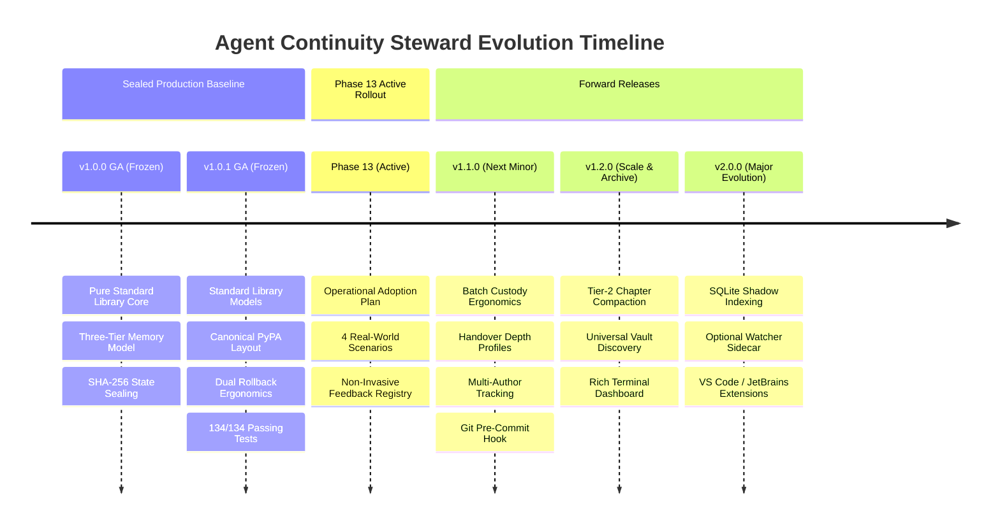
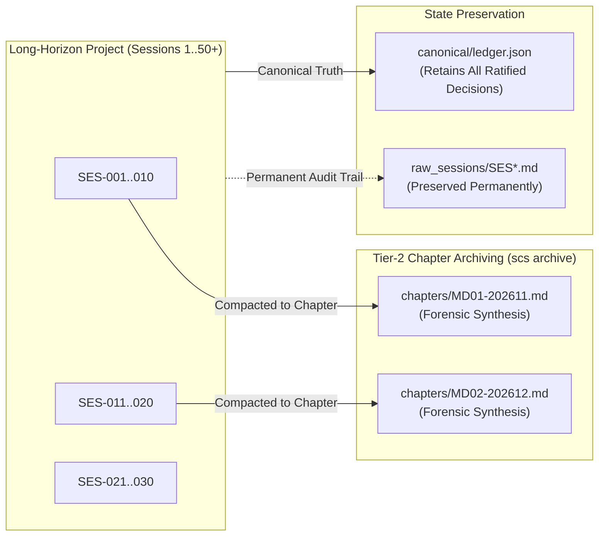

# Agent Continuity Steward (SCS_AG_v2)
## Next-Generation Development Roadmap (v1.1.0 → v1.x → v2.0.0)

**Document Type:** Living Architecture & Engineering Roadmap  
**System:** Session Continuity Steward for Antigravity (SCS_AG_v2)  
**Document Version:** 1.0.0  
**Roadmap Status:** 🟢 **RATIFIED ENGINEERING ROADMAP**  
**Production Baseline:** `v1.0.1 General Availability (GA)` (Immutable)  
**Active Development Branch:** `develop` (`origin/develop`)  
**Authority:** Stability Engineering & Architecture Governance  

---

### 1. Executive Summary & Forward Evolution Strategy

With the formal freezing and publication of `v1.0.1 General Availability (GA)`, the Agent Continuity Steward has established an immutable, production-hardened core:
- **Zero External Runtime Dependencies:** Pure Python standard library implementation.
- **100% Automated Conformance:** 134/134 automated unit, integration, and normative tests passing.
- **Three-Tier Architecture:** Immutable raw evidence (`SES*.md`), staging quarantine (`pending_proposals.json`), and cryptographically sealed machine SSOT (`ledger.json`).
- **Human Custody Gate:** Absolute operator authority over all canonical memory promotions.

This document defines the **forward engineering trajectory** for subsequent releases. In accordance with Phase 13 governance, all forward development is isolated onto the `develop` branch (`origin/develop`), leaving the production release branch `main` and release tag `v1.0.1` completely untouched.



---

### 2. Multi-Tier Release Hierarchy

| Milestone | Target Branch | Primary Focus | Key Capabilities | Schema Impact | Dependency Rule |
| :--- | :---: | :--- | :--- | :---: | :---: |
| **`v1.0.1 GA`** | `main` | **Production Baseline** | Zero-dep stdlib core, 134 tests, PyPA layout, dual rollback syntax | `scs-ledger/1.0` | **Zero (0)** (Stdlib only) |
| **`v1.1.0`** | `develop` | **Ergonomics & Collaboration** | Batch approve/reject, handover profiles, author attribution, git pre-commit hook | Backward compatible | **Zero (0)** (Stdlib only) |
| **`v1.2.0`** | `develop` | **Compaction & Discovery** | Tier-2 chapter archiving (Session 10+), hierarchical vault precedence, rich CLI status | Backward compatible | **Zero (0)** (Stdlib only) |
| **`v2.0.0`** | `develop` / `v2.x` | **Scale & Tooling Ecosystem** | Optional SQLite shadow index, optional filesystem watcher, native IDE extensions | `scs-ledger/2.0` | Zero for core; optional plugins |

---

### 3. Milestone `v1.1.0` — Ergonomics, Collaboration & Developer Tooling

Milestone `v1.1.0` directly addresses operational friction identified in the Phase 13 Feedback Registry ([`V1_X_FEEDBACK_REGISTRY.md`](file:///f:/000_Ai%20Project/AI%20SCS%20HUD/V1_X_FEEDBACK_REGISTRY.md)). It delivers significant operator quality-of-life improvements without altering the underlying storage schema or adding external dependencies.

```
┌──────────────────────────────────────────────────────────────────────────────────┐
│                           v1.1.0 FEATURE ARCHITECTURE                            │
│                                                                                  │
│   ┌───────────────────────────┐          ┌───────────────────────────┐           │
│   │  Batch Custody Shorthand  │          │   Handover Depth Profiles │           │
│   │  scs approve --all        │          │   --profile compact|deep  │           │
│   │  scs approve 1,2,3        │          │   (300 to 2,000+ tokens)  │           │
│   └─────────────┬─────────────┘          └─────────────┬─────────────┘           │
│                 │                                      │                         │
│                 ▼                                      ▼                         │
│   ┌───────────────────────────┐          ┌───────────────────────────┐           │
│   │ Multi-Author Attribution  │          │ Git Pre-Commit Hook Guard │           │
│   │ approved_by metadata      │          │ scripts/scs-pre-commit.py │           │
│   │ git user.name fallback    │          │ O(1) state seal check     │           │
│   └───────────────────────────┘          └───────────────────────────┘           │
└──────────────────────────────────────────────────────────────────────────────────┘
```

#### 3.1 Specification 1.1.1: Batch Custody Operations
- **Motivation (`FDB-101-005`):** High-volume developer sessions accumulate multiple candidate decisions and tasks in staging quarantine. Sequential individual promotions introduce unnecessary typing toil.
- **Detailed Design:**
  - `scs approve --all`: Promotes all quarantined proposals in a single batch, outputting a consolidated summary and computing a single state seal.
  - `scs approve DEC-001,DEC-002,TSK-003`: Accepts comma-separated proposal IDs for selective batch promotion.
  - `scs reject --all`: Clears staging quarantine with an explicit operator confirmation prompt (`Are you sure? [y/N]`).
  - `--yes / -y` flag: Skips confirmation prompt for non-interactive automation scripts.
- **Safety Invariant:** All proposals still undergo individual structural validation prior to promotion. If any single candidate fails validation, the entire batch transaction is aborted.

#### 3.2 Specification 1.1.2: Handover Depth Profiles
- **Motivation (`FDB-101-002`):** Different LLM models and operational tasks require different context densities. Lightweight models benefit from concise summaries, while deep architectural reviews require full forensic evidence quotes.
- **Detailed Design:**
  - Add `--profile <NAME>` flag to `scs handover` (and `/scs handover` skill):
    - `compact`: Produces a high-density, ~300-word digest of active goals, critical constraints, and immediate next tasks. Ideal for fast turnaround subagents or chat resets.
    - `standard` (Default): The certified v1.0.1 handover brief (~800–1,200 tokens) with active decisions, open tasks, constraints, and state seal.
    - `deep`: Exhaustive ~2,000+ token audit brief including evidence quotes, rejected alternatives with causal justifications, and recent snapshot history.
- **Output Consistency:** Output formats remain standard GitHub Markdown, perfectly readable by humans and LLMs alike.

#### 3.3 Specification 1.1.3: Multi-Author Attribution Tracking
- **Motivation (`FDB-101-003`):** In team settings, multiple developers review and approve proposals. Audit logs must distinguish between human reviewers.
- **Detailed Design:**
  - Extend the ratification event payload in `canonical/ledger.json`:
    ```json
    {
      "code": "DEC-20261106-003",
      "statement": "Adopt Pure Python Standard Library for scs_core",
      "author": "avescheong",
      "approved_by": "lead-architect",
      "ratified_at": "2026-11-06T20:30:00+08:00"
    }
    ```
  - Resolution order for `--author`:
    1. CLI flag: `scs approve --author "Jane Doe"`
    2. Git config: `git config user.name`
    3. System user: Environment variable `USER` or `USERNAME`
    4. Fallback: `"human-operator"`

#### 3.4 Specification 1.1.4: Standalone Git Pre-Commit Hook Guard
- **Motivation (`FDB-101-007`):** Ensure team members do not commit corrupted ledgers, broken state seals, or uncommitted staged proposals to git.
- **Detailed Design:**
  - Create a pure standard library pre-commit script `scripts/scs-pre-commit.py`.
  - Provide a CLI helper command:
    ```bash
    scs hook install --git
    ```
  - The hook performs an instantaneous ($< 15\text{ms}$) validation:
    1. Re-hashes `canonical/ledger.json` with SHA-256.
    2. Compares hash against `snapshots/LATEST_SEAL`.
    3. If tampered or desynchronized, aborts commit with clear remediation instructions.

#### 3.5 Specification 1.1.5: Heuristic Subagent Progress Chatter Suppression
- **Motivation (`FDB-101-006`):** Autonomous subagents running iterative search loops generate progress heartbeats that can be misclassified as tasks.
- **Detailed Design:**
  - Add explicit negative regex patterns to `scs_core/heuristics.py`:
    - `r"\[Progress:\s*\d+/\d+\]"`
    - `r"^Turn\s+\d+\s+of\s+\d+"`
    - `r"^Step\s+\d+:\s*(?:running|evaluating|searching)\b"`
  - Ensure zero conversational status strings enter Tier 2 quarantine.

---

### 4. Milestone `v1.2.0` — Compaction, Discovery & Scale

Milestone `v1.2.0` focuses on multi-vault scaling and archival compaction for long-running software projects.



#### 4.1 Specification 1.2.1: Tier-2 Chapter Archiving (Session 10+ Compaction)
- **Problem:** After 50+ sessions, reading raw session histories can become cumbersome.
- **Solution:** Add `scs archive` command that groups completed sessions into 10-session consolidated chapters (`chapters/MD01-*.md`).
- **Invariant:** Raw `SES*.md` files are **never deleted**. The chapter synthesis acts as a higher-level navigational index while retaining cryptographic links to raw evidence.

#### 4.2 Specification 1.2.2: Universal Vault Discovery Precedence
- **Resolution Chain:**
  1. Explicit CLI argument: `--vault <path>`
  2. Active process environment: `SCS_VAULT_PATH`
  3. Local workspace vault: `./.scs_vault/` (co-located in git repo)
  4. Centralized user vault: `~/.scs/vaults/<cwd_name>/` (out-of-repo default)

---

### 5. Phase 2 (v2.0.0) — Formally Deferred Architectural Expansions

To preserve the rock-solid reliability of the v1.x series, the following advanced capabilities remain formally deferred to Phase 2 (v2.0.0):

```
┌──────────────────────────────────────────────────────────────────────────────────┐
│                    PHASE 2 (v2.0.0) DEFERRED CAPABILITIES                        │
│                                                                                  │
│  1. SQLite Shadow Indexing:                                                      │
│     Read-only SQLite query engine for mega-repositories (>10,000 decisions).     │
│     Flat JSON remains 100% adequate and sub-second for all v1.x projects.        │
│                                                                                  │
│  2. Optional Filesystem Watcher Sidecar:                                         │
│     Background daemon automatically capturing transcripts on file writes.        │
│     Explicit slash commands (/scs record) remain primary in v1.x.                │
│                                                                                  │
│  3. Cross-Vault Vector Embeddings & Semantic Search:                             │
│     Requires external ML dependencies (ONNX, PyTorch, vector DB).               │
│     Strictly excluded from v1.x to protect zero-dependency invariant.            │
│                                                                                  │
│  4. Native IDE Sidebar Extensions:                                               │
│     Dedicated VS Code and JetBrains GUI panels rendering approval cards.         │
│     Full architecture blueprint preserved in FUTURE_ARCHITECTURE.md.             │
└──────────────────────────────────────────────────────────────────────────────────┘
```

---

### 6. Architectural Boundaries & "The Unbreakable Invariants"

All future engineering on `develop`, feature branches, and future release candidates must conform to the following non-negotiable architectural invariants:

1. **Zero External Runtime Dependencies:** The core package (`scs_core`) must execute on standard Python 3.11+ using the standard library alone. No third-party packages in `dependencies = []`.
2. **Mandatory Human Custody Gate:** No AI model or autonomous agent may write directly to `canonical/ledger.json`. All automated extractions must enter Tier 2 Quarantine.
3. **Machine SSOT with One-Way Projections:** `canonical/ledger.json` is the sole machine single source of truth. Markdown files (`DECISIONS.md`, `TASKS.md`, `CONSTRAINTS.md`, `REJECTED_OPTIONS.md`) are deterministic one-way projections. Reverse-parsing markdown is forbidden.
4. **Deterministic SHA-256 State Sealing:** Every canonical state change must compute a deterministic SHA-256 hash across sorted JSON keys.
5. **Strict Backward Compatibility:** Every future release (`v1.1.0`, `v1.2.0`, `v1.x`) must be capable of reading and operating upon vaults created by `v1.0.0` and `v1.0.1` without manual migration.
6. **Regression Floor:** The existing 134/134 automated test suite serves as an unbreakable regression floor. No PR may merge into `develop` with skipped, broken, or degraded tests.

---

### 7. Governance, Review Gates & Attestation

This roadmap establishes the authorized engineering direction for future versions of the Agent Continuity Steward.

```text
================================================================================
                    NEXT DEVELOPMENT ROADMAP SIGN-OFF
================================================================================
Document:                   NEXT_DEVELOPMENT_ROADMAP.md
Status:                     APPROVED & RATIFIED
Production Baseline:        v1.0.1 GA (Commit 988cce7, Tag v1.0.1) - IMMUTABLE
Active Development Ref:     refs/heads/develop (Tracking origin/develop)
Next Minor Milestone:       v1.1.0 (Target: Q4 2026 / Q1 2027)
Governing Principles:       Evidence-First, Zero-Dependency, Human Custody Gate
================================================================================
```

*Ratified by Stability Engineering & Architecture Governance.*  
*Timestamp: 2026-11-06T20:55:00+08:00*
