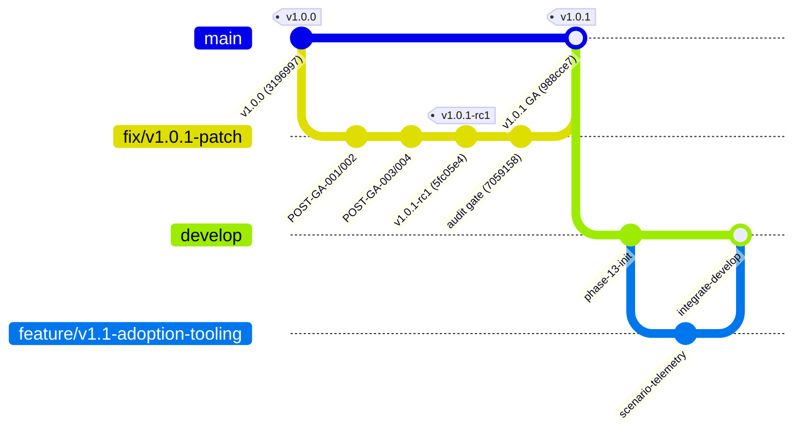
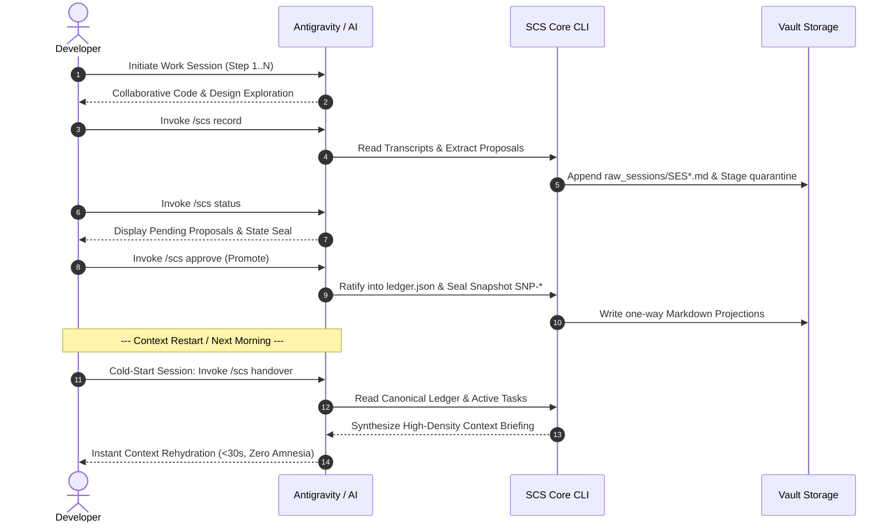
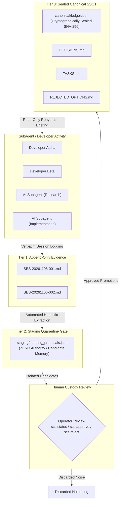
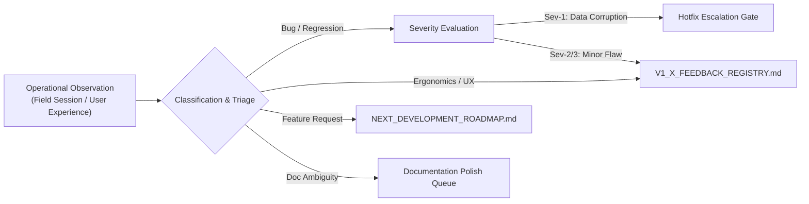

# Agent Continuity Steward (SCS_AG_v2)
## Phase 13 — v1.x Operational Adoption & Ecosystem Governance Plan

**Document Type:** Formal Phase Operational Plan  
**System:** Session Continuity Steward for Antigravity (SCS_AG_v2)  
**Document Version:** 1.0.0  
**Phase Status:** 🟢 **ACTIVE OPERATIONAL EXECUTION**  
**Production Baseline:** `v1.0.1 General Availability (GA)` (Immutable)  
**Production Commit SHA:** `988cce7dc8d060532f4e694aa8228baca6248ebb`  
**Production Wheel Package:** `agent_continuity_steward-1.0.1-py3-none-any.whl`  
**Wheel SHA-256:** `75d42043cc217dc54b5ddcd6c1d49548a3fa0360d5bfc36139a6c2d365732089`  
**Active Development Branch:** `develop` (`origin/develop`)  
**Authority:** Stability Engineering & Architecture Governance  

---

### 1. Executive Summary & Production Baseline Immutability

Following the successful completion of Phase 12 (v1.0.1 Defect Remediation, Clean-Room Verification, and Official GitHub Publication), the project enters **Phase 13: v1.x Operational Adoption & Ecosystem Governance**.

Phase 13 marks a fundamental transition in the software lifecycle:
- **Phases 1 through 12** were focused on architecture construction, core engine implementation, quarantine gate validation, normative regression suites, and release packaging.
- **Phase 13** shifts the focus to real-world operational adoption, multi-scenario field execution, structured non-invasive feedback ingestion, and long-horizon roadmap planning.

```
┌──────────────────────────────────────────────────────────────────────────────────┐
│                             PRODUCTION STATUS: FROZEN                            │
│  - Baseline Version:       v1.0.1 General Availability (GA)                     │
│  - Production Commit:      988cce7dc8d060532f4e694aa8228baca6248ebb             │
│  - Automated Test Suite:   134/134 Tests Passing (100% Conformance)              │
│  - Runtime Dependencies:   Zero (Standard Library Only)                         │
│  - Integrity Rule:         Release branches & GA tags are strictly IMMUTABLE    │
└──────────────────────────────────────────────────────────────────────────────────┘
```

#### Guiding Mandates of Phase 13:
1. **Production Baseline Immutability:** `v1.0.1` is the certified, sealed GA production release. It is treated as an immutable baseline. No commits, re-tagging, or force-pushes shall touch the GA release tag or production release branches.
2. **Branching Isolation:** All future engineering investigations, tooling extensions, and preparatory work are strictly isolated onto the `develop` branch (`origin/develop`) and feature branches branched therefrom.
3. **Non-Invasive Feedback Collection:** Real-world operator feedback, friction points, and telemetry are ingested systematically into [`V1_X_FEEDBACK_REGISTRY.md`](file:///f:/000_Ai%20Project/AI%20SCS%20HUD/V1_X_FEEDBACK_REGISTRY.md) without altering the GA production codebase.
4. **Evidence-First Governance:** Every adoption claim, feedback item, and roadmap prioritization must be backed by concrete evidentiary records, reproduction steps, and verifiable logs.

---

### 2. Branching Topology & Governance Invariants

To guarantee that production stability is never compromised while forward development proceeds, Phase 13 establishes the following multi-branch topology:



#### Branch Governance Policies:

| Branch | Access / Protection | Purpose | Invariant Rules |
| :--- | :--- | :--- | :--- |
| **`main`** | **Protected / Read-Only** | Production GA Release Branch | Strict immutability. Contains exclusively verified GA releases (`v1.0.0`, `v1.0.1`). Direct commits and force-pushes are strictly forbidden. |
| **`develop`** | **Active Engineering** | Integration Branch for Future Releases | Established at commit `988cce7` (v1.0.1). Target branch for all Phase 13 operational documentation, feedback synthesis, and v1.1.0 feature development. |
| **`feature/*`** | **Topic Isolation** | Ephemeral Feature Development | Branched from `develop`. Must pass all 134 automated tests before opening PR to `develop`. |
| **`hotfix/*`** | **Restricted / Exceptional** | Critical Production Patch (Sev-1 Only) | Only opened if a critical, reproducible defect compromises data integrity in the immutable baseline. None currently required. |

---

### 3. Real-World Operational Adoption Scenarios

Phase 13 defines four core operational scenarios representing the spectrum of AI continuity requirements:

```
┌──────────────────────────────────────────────────────────────────────────────────┐
│                     FOUR OPERATIONAL ADOPTION SCENARIOS                          │
│                                                                                  │
│   ┌───────────────────────────┐          ┌───────────────────────────┐           │
│   │        SCENARIO 1         │          │        SCENARIO 2         │           │
│   │    Personal AI Continuity │          │     Project Continuity    │           │
│   │ (Solo Dev / Daily Context)│          │ (Long-Horizon Lifecycle)  │           │
│   └─────────────┬─────────────┘          └─────────────┬─────────────┘           │
│                 │                                      │                         │
│                 ▼                                      ▼                         │
│   ┌───────────────────────────┐          ┌───────────────────────────┐           │
│   │        SCENARIO 3         │          │        SCENARIO 4         │           │
│   │  Team Workflow Continuity │          │ External User Onboarding  │           │
│   │ (Multi-Agent / Swarm Sync)│          │ (Clean Install / Journey) │           │
│   └───────────────────────────┘          └───────────────────────────┘           │
└──────────────────────────────────────────────────────────────────────────────────┘
```

---

#### 3.1 Scenario 1: Personal AI Continuity (Solo Practitioner / Daily Context Rehydration)

**Target Persona:** An individual developer or researcher using Antigravity / LLM-assisted workflows across multi-day coding sessions.  
**Core Problem:** Session Amnesia across chat context restarts. Context window exhaustion forces conversation resets, causing the AI to lose track of why architectural choices were made and re-proposing previously rejected libraries.

##### Operational Lifecycle:


##### Evaluation Metrics & Invariants:
- **Rehydration Latency:** Context recovery accomplished in $< 30$ seconds without manual copy-paste.
- **Negative Knowledge Preservation:** Zero instances of re-proposing rejected options cataloged in `canonical/REJECTED_OPTIONS.md`.
- **Quarantine Hygiene:** Ephemeral conversational fragments are rejected during review; only genuine architecture decisions enter the ledger.
- **Target Benchmark Score:** Cold-start rehydration score $\ge 9.5 / 10.0$.

---

#### 3.2 Scenario 2: Project Continuity (Long-Horizon Software Lifecycle)

**Target Persona:** Project maintainer, tech lead, or product steward overseeing a software repository across weeks, months, or version releases.  
**Core Problem:** Architectural drift over time. Code evolves, but the causal reasoning behind constraints, ADRs, and technical debt remains buried in closed PRs or lost developer memory.

##### Operational Lifecycle:
1. **Vault Placement & Custody:** The project vault is maintained either in the user's home directory (`~/.scs/vaults/<project-name>/`) or configured within the repository environment.
2. **Cryptographic State Sealing:** Every approved architectural milestone generates a deterministic SHA-256 snapshot (`snapshots/SNP-{YYYYMMDD}-{NNN}.json`) matching:
   $$\text{Seal} = \text{SHA-256}\Big(\text{JSON\_Encode}\big(\text{ledger.json}, \text{sort\_keys}=\text{True}, \text{indent}=2\big)\Big)$$
3. **One-Way Markdown Projections:** The machine SSOT continuously renders human-readable documentation:
   - `docs/DECISIONS.md` — Active architectural decisions with evidence quotes.
   - `docs/CONSTRAINTS.md` — Hard operational constraints and performance budgets.
   - `docs/TASKS.md` — Open, in-progress, and completed work streams.
   - `docs/REJECTED_OPTIONS.md` — Permanently banned technical paths with explicit causal rationale.
4. **Tamper Detection & State Audit:** Running `scs status` executes an $O(1)$ cryptographic check comparing `LATEST_SEAL` against `canonical/ledger.json`. Any external file tampering is immediately flagged.
5. **Speculative Rollback:** If a multi-session refactoring experiment fails, the project state is safely reverted to a pristine historical snapshot via `scs rollback --snapshot <CODE>`.

##### Evaluation Metrics & Invariants:
- **Longitudinal Hash Integrity:** 100% tamper detection across all sessions.
- **Zero Schema Drift:** All snapshots strictly conform to `scs-ledger/1.0`.
- **Bidirectional Traceability:** Every decision cites its `source_session_code` and verbatim dialogue quote.

---

#### 3.3 Scenario 3: Team Workflow Continuity (Multi-Agent & Multi-Developer Swarm)

**Target Persona:** Engineering teams where multiple developers and autonomous AI subagents (e.g., Codebase Researcher, Reviewer, Refactoring Agents) operate asynchronously on a shared repository.  
**Core Problem:** Memory collisions and hallucination clobbering. Autonomous agents attempting to write directly to shared memory pollute canonical records with conversational noise, speculative proposals, and inconsistent task definitions.

##### Operational Lifecycle:


##### Evaluation Metrics & Invariants:
- **Strict Separation of Powers:** Autonomous agents are physically prohibited from writing to `canonical/ledger.json`. All agent extractions enter Tier 2 Quarantine.
- **Noise Rejection Ratio:** $>90\%$ of conversational chatter and status summaries discarded before canonical commitment.
- **Asynchronous Rehydration:** Developers onboarding to a team task rehydrate active state via `scs handover` with identical mental models.

---

#### 3.4 Scenario 4: External User Onboarding (Clean-Room / Zero-Knowledge Developer Journey)

**Target Persona:** An external software engineer or student discovering Agent Continuity Steward on GitHub for the first time, operating in a clean environment without pre-configured dependencies.  
**Core Problem:** Fragile installation steps, broken symlinks, undeclared dependencies, or non-intuitive command sequences causing onboarding abandonment.

##### Operational Lifecycle (The 10-Step Journey):
1. **Prerequisite Check:** Python 3.11+ installed; standard terminal (PowerShell, Bash, Zsh).
2. **Clean Package Installation:**
   ```bash
   pip install agent_continuity_steward-1.0.1-py3-none-any.whl
   ```
   *Verification:* Zero external packages downloaded; pure standard library installation.
3. **CLI Availability:** Running `scs --help` renders complete command synopsis.
4. **Vault Initialization:** Running `scs new --name onboarding-demo` creates directory structure.
5. **Initial State Verification:** Running `scs status` reports pristine empty vault with active seal.
6. **Mock Dialogue Ingestion:** Ingesting sample session dialogue via `scs record`.
7. **Quarantine Inspection:** Running `scs status` shows candidate decision and task proposals.
8. **Operator Ratification:** Promoting valid candidates via `scs approve`.
9. **One-Way Projection Inspection:** Reviewing generated `DECISIONS.md` and `TASKS.md`.
10. **Cold-Start Handover Briefing:** Executing `scs handover` to generate rehydration brief.

##### Evaluation Metrics & Invariants:
- **First-Attempt Success Rate:** 100% completion of the 10-step journey on clean environments.
- **Zero-Dependency Guarantee:** Absolute zero pip package dependencies outside Python stdlib.
- **Time-to-First-Snapshot:** Under 3 minutes from download to verified cryptographic snapshot.

---

### 4. Non-Invasive Operational Feedback Ingestion

To adhere to the immutable production baseline mandate, all operational feedback, user friction, telemetry observations, and edge-case reports are captured exclusively through the **v1.x Feedback Ingestion Pipeline**:



#### Feedback Triage Classification Matrix:

| Severity | Definition | Target Resolution | Invariant Action |
| :---: | :--- | :--- | :--- |
| **Sev-1** | **Critical GA Data Corruption / Crash** | Emergency Hotfix (`v1.0.2`) | Triggers isolated hotfix branch off `main`. Requires clean-room test reproduction. (None currently known). |
| **Sev-2** | **Ergonomic Friction / Non-Fatal Defect** | Minor Release (`v1.1.0`) | Logged in feedback registry; scheduled for v1.1.0 development on `develop`. |
| **Sev-3** | **Feature Enhancement / Scale Optimization** | Minor/Major Release (`v1.x` / `v2.0`) | Evaluated and scheduled in [`NEXT_DEVELOPMENT_ROADMAP.md`](file:///f:/000_Ai%20Project/AI%20SCS%20HUD/NEXT_DEVELOPMENT_ROADMAP.md). |
| **Sev-4** | **Documentation Ambiguity / Guide Polish** | Continuous Update on `develop` | Direct clarification in documentation without code mutation. |

---

### 5. Phase 13 Milestones & Governance Gates

Phase 13 is organized into four sequential milestones:

```
┌──────────────────────────────────────────────────────────────────────────────────┐
│                           PHASE 13 MILESTONE SCHEDULE                            │
│                                                                                  │
│  [M13.1: Operational Foundation] ──► [M13.2: Adoption Scenario Field Runs]       │
│  - v1.0.1 Baseline Frozen            - Scenario 1 (Personal AI Continuity)       │
│  - develop Branch Published          - Scenario 2 (Project Continuity)           │
│  - Feedback Registry Initialized     - Scenario 3 (Team Workflow Continuity)     │
│  - Next Roadmap Structured           - Scenario 4 (External User Onboarding)     │
│                                                          │                       │
│                                                          ▼                       │
│  [M13.4: v1.1.0 Engineering Spec]  ◄── [M13.3: Feedback Synthesis & Triage]     │
│  - Formal v1.1.0 Design Doc          - Registry Pattern Synthesis                │
│  - Test Strategy for v1.1.0          - Triage Review & Prioritization            │
│  - Phase 13 Closure Report           - Ergonomics & Scalability Assessment       │
└──────────────────────────────────────────────────────────────────────────────────┘
```

#### Detailed Milestone Specifications:

- **Milestone 13.1 (Complete):** Operational Plan, Feedback Registry, and Development Branch Foundation.
  - Deliverables: `PHASE_13_OPERATIONAL_ADOPTION_PLAN.md`, `V1_X_FEEDBACK_REGISTRY.md`, `NEXT_DEVELOPMENT_ROADMAP.md`, `origin/develop` branch established.
- **Milestone 13.2:** Execution of Adoption Scenarios across live development workflows, capturing raw telemetry and operator friction.
- **Milestone 13.3:** Comprehensive triage of all recorded feedback entries, identifying recurring ergonomic patterns and usability bottlenecks.
- **Milestone 13.4:** Formal sign-off on the v1.1.0 technical design specification and phase closure attestation.

---

### 6. Evidence-First Verification Checklist

Every operational finding must satisfy the following evidentiary standards before triage:

- [ ] **Verbatim Transcript Evidence:** Every friction point is accompanied by the exact terminal command, CLI output, or session dialogue snippet.
- [ ] **Environment Provenance:** Operating system, Python minor version, working directory layout, and vault mode recorded.
- [ ] **Zero-Pollution Verification:** Production baseline `v1.0.1` and release tag remain unmodified throughout the testing cycle.
- [ ] **Cryptographic Verification:** State seals verified before and after each scenario execution.

---

### 7. Governance Attestation

This document establishes the binding operational plan for Phase 13 of the Agent Continuity Steward project. All activities shall adhere strictly to the immutable baseline and evidence-first principles defined herein.

*Approved and Ratified by Stability Engineering & Architecture Governance.*  
*Timestamp: 2026-11-06T20:55:00+08:00*
