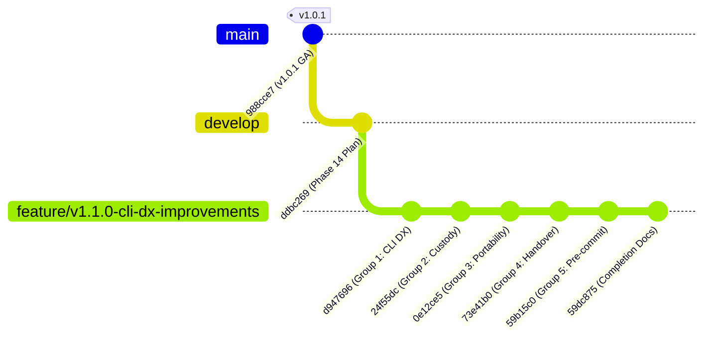

# Agent Continuity Steward (SCS_AG_v2)
## Phase 14 — Develop Merge Readiness & Promotion Assessment

**Document Type:** Formal Promotion Assessment & Merge Topology Report  
**System:** Agent Continuity Steward for Antigravity (SCS_AG_v2)  
**Milestone:** Phase 14 (v1.1.0 Promotion Preparation)  
**Document Version:** 1.0.0  
**Audit Timestamp:** 2026-11-07T06:31:00+08:00  
**Target Promotion Branch:** `develop` (`origin/develop`)  
**Source Feature Branch:** `feature/v1.1.0-cli-dx-improvements` (`origin/feature/v1.1.0-cli-dx-improvements`)  
**Production Baseline:** `main` (`v1.0.1 GA` @ `988cce7`) — **FROZEN & IMMUTABLE**  
**Local Checkpoint Baseline:** `D:\000. GITHUB\Session_Continuity_Steward` @ `59dc875`  
**Status:** 🚀 **MERGE SIMULATION SUCCESSFUL — READY FOR OPERATOR RATIFICATION**  

---

### 1. Executive Summary

This report provides the formal pre-merge integration assessment for promoting Phase 14 v1.1.0 feature development into the integration branch `develop`.

All five Phase 14 engineering groups (`FDB-101-001` through `FDB-101-014`) have been implemented, tested, and validated on topic branch `feature/v1.1.0-cli-dx-improvements`. The local operational checkpoint repository (`Session_Continuity_Steward`) has been synchronized to commit `59dc875` and confirmed passing 100% of the release verification harness.

A complete merge simulation against `develop` confirmed that `develop` is a direct ancestor of the feature branch, with **zero merge conflicts** and **100% fast-forward mergeability**.

```
┌──────────────────────────────────────────────────────────────────────────────────┐
│                         MERGE READINESS ASSESSMENT SUMMARY                       │
│                                                                                  │
│  * Target Branch:           develop (Checked out, clean, @ ddbc269)              │
│  * Source Branch:           feature/v1.1.0-cli-dx-improvements (@ 59dc875)       │
│  * Merge Base:              ddbc2697f8c39ccd5d2c95d9c11af030c4b0901b             │
│  * Divergent Commits:       0 commits behind / 6 commits ahead                   │
│  * Conflict Analysis:       0 conflicts (git merge-tree exit code 0)             │
│  * Recommended Strategy:    Fast-Forward Only (--ff-only)                        │
│  * Conformance Pass Rate:   192/192 tests passing (100% Green)                   │
│  * Checkpoint Anchor:       Session_Continuity_Steward verified @ 59dc875       │
│  * Production Baseline:     main @ 988cce7 (100% Frozen & Untouched)             │
└──────────────────────────────────────────────────────────────────────────────────┘
```

---

### 2. Current Branch Topology & Commit Lineage



#### Exact Commit Reference Table

| Role / Entity | Branch / Tag | Commit SHA | Status / Purpose |
|---|---|---|---|
| **Production Baseline** | `main` | `988cce7dc8d060532f4e694aa8228baca6248ebb` | 🔒 Immutable v1.0.1 GA release |
| **Production Release Tag** | `v1.0.1` | `60a12f4f938dc592b9aa516b8636af738f97a619` | 🏷️ Certified production release tag |
| **Target Integration Branch** | `develop` | `ddbc2697f8c39ccd5d2c95d9c11af030c4b0901b` | 🎯 Checked out, clean, awaiting fast-forward |
| **Merge Base** | `merge-base` | `ddbc2697f8c39ccd5d2c95d9c11af030c4b0901b` | ⚓ Exact common ancestor |
| **Source Feature Branch** | `feature/...` | `59dc8759db52e013feb631d893191f83d6874e74` | 📦 6 commits ahead, 0 commits behind |
| **Local Checkpoint Anchor** | `Session_...` | `59dc8759db52e013feb631d893191f83d6874e74` | 🛡️ Verified offline recovery baseline |

---

### 3. Develop Branch Pre-Flight Inspection

The local checkout of `develop` was inspected prior to simulation:

1. **Active Branch**: `develop`
2. **Current HEAD SHA**: `ddbc2697f8c39ccd5d2c95d9c11af030c4b0901b`
3. **Working Tree Cleanliness**:
   ```text
   On branch develop
   Your branch is up to date with 'origin/develop'.
   nothing to commit, working tree clean
   ```
4. **Commit Sequence Check**:
   Latest commit is `ddbc269` (`docs(phase14): establish v1.1.0 formal engineering implementation plan`). Zero unexpected or divergent commits exist on `develop`.

---

### 4. Promotion Simulation & Conflict Analysis

Simulation was performed using `git merge-tree`:

```bash
git merge-tree $(git merge-base develop feature/v1.1.0-cli-dx-improvements) develop feature/v1.1.0-cli-dx-improvements
```

#### Simulation Findings:
- **Ancestor Evaluation**: `git merge-base --is-ancestor develop feature/v1.1.0-cli-dx-improvements` returned exit code `0`.
- **Tree Synthesis**: `git merge-tree --write-tree develop feature/v1.1.0-cli-dx-improvements` generated tree hash `50c6a74849901f286c378ac42c3b409d11d2a5b8` with exit code `0`.
- **Conflict Count**: **0 conflicts**.
- **Mergeability Classification**: **Clean Fast-Forward (`--ff-only`)**.

Because no commits were added to `develop` while `feature/v1.1.0-cli-dx-improvements` was developed, the feature branch represents a pure linear continuation of `develop`.

---

### 5. Recommended Promotion & Merge Strategy

#### Strategy: Fast-Forward Only (`--ff-only`)
- **Rationale**:
  - Avoids non-semantic merge commits that clutter Git history.
  - Preserves exact commit hashes (`d947696` through `59dc875`) established during Phase 14 verification.
  - Matches the exact commit verified in the local checkpoint repository (`Session_Continuity_Steward`).

#### Exact Execution Commands (For Human Review):
```bash
# 1. Ensure active branch is develop
git checkout develop

# 2. Execute fast-forward merge
git merge --ff-only feature/v1.1.0-cli-dx-improvements

# 3. Push promoted develop branch to remote
git push origin develop
```

---

### 6. Required Post-Merge Validation Steps

Immediately following execution of the fast-forward merge into `develop`:

1. **Post-Merge Conformance Harness**:
   Execute the full dual-layer release verification suite on `develop`:
   ```powershell
   python scripts/verify_release.py
   ```
   *Expectation: 192/192 tests passing (100% Green).*

2. **Tag Release Candidate 1 (`v1.1.0-rc1`)**:
   Create and push pre-release candidate tag on `develop` for human operator testing:
   ```bash
   git tag -a v1.1.0-rc1 -m "Release Candidate v1.1.0-rc1: CLI Dual Syntax, Attribution, Depth Profiles, and Git Hook Verification"
   git push origin v1.1.0-rc1
   ```

3. **User Acceptance Testing (UAT)**:
   Verify end-to-end developer experience using the new capabilities on `develop`:
   - `scs new --code TEST --name "Test Project"`
   - `scs record --project TEST --file <markdown_notes>`
   - `scs handover TEST --stdout --profile compact`
   - `scs hook install --git`

4. **Production Promotion Hold**:
   Under no circumstances merge `develop` into `main` until the human operator completes UAT on `v1.1.0-rc1` and explicitly authorizes production promotion.

---

### 7. Governance Confirmation & Hold State

- **Branch State:** Checked out on `develop` at `ddbc269`.
- **Simulation Result:** Validated clean fast-forward (0 conflicts).
- **Hold Directive:** **Awaiting human operator approval.** No merge, no tag, and no modification of `main` will occur without explicit authorization.
