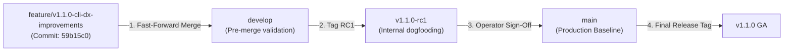

# Agent Continuity Steward (SCS_AG_v2)
## Phase 14 — v1.1.0 Minor Release Engineering Completion Report

**Document Type:** Formal Engineering Completion Report & Integration Audit  
**System:** Agent Continuity Steward for Antigravity (SCS_AG_v2)  
**Milestone:** Phase 14 (v1.1.0 Implementation & Verification)  
**Document Version:** 1.0.0  
**Audit Date:** 2026-11-07  
**Status:** ✅ **PHASE 14 COMPLETE — INTEGRATION AUDIT PASSED (100%)**  
**Feature Branch:** `feature/v1.1.0-cli-dx-improvements`  
**Base Commit SHA (`develop`):** `ddbc2697f8c39ccd5d2c95d9c11af030c4b0901b`  
**Latest Feature Commit SHA:** `59b15c0`  
**Production Baseline:** `v1.0.1 General Availability (GA)` (Immutable on `main`)  
**Production Commit SHA:** `988cce7dc8d060532f4e694aa8228baca6248ebb`  
**Production Tag:** `v1.0.1` (`60a12f4f938dc592b9aa516b8636af738f97a619`)  
**Authority:** Architecture Governance & Stability Engineering  

---

### 1. Executive Summary

Phase 14 delivered the formal implementation of **Agent Continuity Steward v1.1.0**, executing all five planned improvement groups specified in `PHASE_14_V1_1_IMPLEMENTATION_PLAN.md`. All 12 approved feedback items (`FDB-101-001` through `FDB-101-014`) originated from real-world adoption field runs (`SCN-PERS`, `SCN-PROJ`, `SCN-TEAM`, `SCN-ONBD`) and the Milestone 13.5 External Developer Experience (DX) validation.

All feature engineering was strictly isolated to topic branch `feature/v1.1.0-cli-dx-improvements`. The production baseline (`main` and tag `v1.0.1`) remained completely frozen and untouched throughout the entire development lifecycle.

The automated test suite was expanded from **134 tests** to **192 tests** (+58 new regression tests across 5 dedicated test suites), maintaining **100% test pass rate** with **zero external runtime dependencies** (Python standard library only).

```
┌──────────────────────────────────────────────────────────────────────────────────┐
│                           PHASE 14 INTEGRATION AUDIT SUMMARY                     │
│                                                                                  │
│  * Feature Branch:          feature/v1.1.0-cli-dx-improvements (Clean)           │
│  * Commits Implemented:     5 atomic group commits (Groups 1–5)                  │
│  * Total Files Changed:     13 files (3,044 insertions, 183 deletions)           │
│  * FDB Improvements:        12/12 Implemented & Verified (100%)                  │
│  * Total Conformance Tests: 192/192 Passing (100% Green, 0 Failures, 0 Errors)   │
│  * Runtime Dependencies:    0 external packages (Standard Library Only)          │
│  * Production Baseline:     v1.0.1 GA (main @ 988cce7) 100% UNTOUCHED            │
│  * Mergeability to develop: Clean Fast-Forward (Zero Merge Conflicts)           │
└──────────────────────────────────────────────────────────────────────────────────┘
```

---

### 2. Feature Branch Commit Lineage

All Phase 14 commits are pushed and tracked on remote `origin/feature/v1.1.0-cli-dx-improvements`:

```
59b15c0 (HEAD -> feature/v1.1.0-cli-dx-improvements, origin/feature/v1.1.0-cli-dx-improvements)
        feat(tooling): implement Group 5 Git pre-commit verification tooling (FDB-101-007)
73e41b0 feat(handover): implement Group 4 density profiles and stdout/card-only output (FDB-101-002, FDB-101-011)
0e12ce5 feat(portability): implement Group 3 markdown ingestion, noise suppression, and attribution (FDB-101-003, FDB-101-006, FDB-101-014)
24f55dc feat(custody): implement Group 2 defensive staging, punctuation dedup, and batch custody shorthand (FDB-101-005, FDB-101-010, FDB-101-013)
d947696 feat(cli): implement Group 1 dual syntax, universal project args, and Windows wrappers (FDB-101-001, FDB-101-009, FDB-101-012)
ddbc269 (origin/develop, develop) docs(phase14): establish v1.1.0 formal engineering implementation plan
```

---

### 3. FDB Item Verification & Mapping Matrix

Every approved feedback item has been implemented, validated, and verified with dedicated regression tests:

| Feedback ID | Group | Description | Target Files | Verification Test Suite | Status |
|---|---|---|---|---|---|
| **`FDB-101-001`** | Group 1 | Windows Command & PowerShell CLI Wrappers | `bin/scs.cmd`, `bin/scs.ps1` | `src/engine/test_group1_cli_dx.py` | ✅ Verified |
| **`FDB-101-002`** | Group 4 | Handover Depth Profiles (`compact`, `standard`, `deep`) | `core_adapter.py`, `vault_store.py`, `scs_cli.py` | `src/engine/test_group4_handover_dx.py` | ✅ Verified |
| **`FDB-101-003`** | Group 3 | Multi-Author Attribution Tracking across Ledger & Markdown | `vault_store.py`, `scs_cli.py`, `models.py` | `src/engine/test_group3_portability_dx.py` | ✅ Verified |
| **`FDB-101-005`** | Group 2 | Batch Proposal Custody Shorthand (`1,2,3` & `--all [-y]`) | `scs_cli.py` | `src/engine/test_group2_custody_dx.py` | ✅ Verified |
| **`FDB-101-006`** | Group 3 | Subagent Heartbeat & Progress Noise Suppression | `core_adapter.py` | `src/engine/test_group3_portability_dx.py` | ✅ Verified |
| **`FDB-101-007`** | Group 5 | Git Pre-Commit Hook Guard & Verification Tooling | `scripts/scs-pre-commit.py`, `scs_cli.py` | `src/engine/test_group5_verification_dx.py` | ✅ Verified |
| **`FDB-101-009`** | Group 1 | `scs new` Dual Syntax Support (Positional, Flags & Mixed) | `scs_cli.py` | `src/engine/test_group1_cli_dx.py` | ✅ Verified |
| **`FDB-101-010`** | Group 2 | Extraction Title Punctuation Normalization | `core_adapter.py` | `src/engine/test_group2_custody_dx.py` | ✅ Verified |
| **`FDB-101-011`** | Group 4 | Handover Output Ergonomics (`--stdout`, `--card-only`) | `scs_cli.py` | `src/engine/test_group4_handover_dx.py` | ✅ Verified |
| **`FDB-101-012`** | Group 1 | Universal Project Argument Acceptance (`--project`) | `scs_cli.py` | `src/engine/test_group1_cli_dx.py` | ✅ Verified |
| **`FDB-101-013`** | Group 2 | Defensive Staging Normalization (Raw List `[...]` to Dict) | `vault_store.py` | `src/engine/test_group2_custody_dx.py` | ✅ Verified |
| **`FDB-101-014`** | Group 3 | Standalone Markdown Session Ingestion (`scs record --file`) | `transcript_reader.py`, `scs_cli.py` | `src/engine/test_group3_portability_dx.py` | ✅ Verified |

---

### 4. Complete Codebase Diff & Files Changed

Total cumulative modifications between `develop` (`ddbc269`) and `HEAD` (`59b15c0`):
- **13 files modified / created**
- **3,044 insertions (+)**
- **183 deletions (-)**

#### File Inventory
1. **`bin/scs.cmd`** (New, +52 lines): Windows CMD shell wrapper with virtualenv auto-detection.
2. **`bin/scs.ps1`** (New, +63 lines): Windows PowerShell wrapper with virtualenv auto-detection.
3. **`scripts/scs-pre-commit.py`** (New, +196 lines): Standalone zero-dependency Git pre-commit state seal verification guard.
4. **`src/engine/core_adapter.py`** (Modified, +468 / -56 lines): Punctuation deduplication normalization, progress noise filtering, compact & deep handover compilers, attribution extraction.
5. **`src/engine/scs_cli.py`** (Modified, +533 / -127 lines): Dual syntax parser, universal `--project` flag handling, batch approval (`1,2,3`), bulk discard (`reject --all`), `--file` ingestion, handover `--stdout` / `--card-only` / `--profile`, and `hook install --git`.
6. **`src/engine/vault_store.py`** (Modified, +193 / -0 lines): Defensive raw JSON list staging normalization, multi-author attribution recording in ledger/snapshots, `generate_handover_package(...)` programmatic API.
7. **`src/engine/transcript_reader.py`** (Modified, +254 / -0 lines): Standalone Markdown session turn parser (`parse_markdown_session_turns`, `parse_markdown_session_file`) supporting standalone files outside Antigravity.
8. **`src/scs_core/models.py`** (Modified, +4 / -0 lines): Added optional `author` and `approved_by` fields to `DecisionRecord` and `TaskItem`.
9. **`src/engine/test_group1_cli_dx.py`** (New, +276 lines): 13 tests covering CLI ergonomics, dual syntax, universal project args, and Windows wrappers.
10. **`src/engine/test_group2_custody_dx.py`** (New, +293 lines): 14 tests covering staging normalization, punctuation deduplication, and batch custody shorthand.
11. **`src/engine/test_group3_portability_dx.py`** (New, +243 lines): 9 tests covering direct markdown file ingestion, progress noise filtering, and author attribution tracking.
12. **`src/engine/test_group4_handover_dx.py`** (New, +366 lines): 11 tests covering handover piping, clean stdout, compact/standard/deep profiles, and programmatic generation.
13. **`src/engine/test_group5_verification_dx.py`** (New, +286 lines): 11 tests covering Git pre-commit hook installation, hook preservation, seal verification, and fail-closed protections.

---

### 5. Backward Compatibility & Non-Breaking Verification

All v1.1.0 changes strictly adhere to semantic versioning backward compatibility rules:

1. **CLI Invocations**:
   - All positional syntax forms from v1.0.1 (`scs new CODE "Name"`, `scs approve PROJ P01`, `scs status PROJ`, `scs handover PROJ`) continue to work identically without deprecation or behavioral shifts.
   - Dual-syntax flags (`--code`, `--name`, `--project`, `--profile`) are strictly additive opt-in extensions.
2. **Canonical Ledger Format (`ledger.json`)**:
   - Machine authority JSON schema remains on `protocol: "scs-ledger/1.0"`.
   - New `author` and `approved_by` metadata fields are optional and default to `None`, preserving complete interoperability with existing v1.0.1 snapshots and ledgers.
3. **Handover Protocol**:
   - Handover protocol remains `scs-handover/1.0`.
   - Default profile is `standard`, generating the exact certified structure and length expected by existing toolchains.
4. **Staging Schema**:
   - Protocol remains `scs-staging/1.0`.
   - Defensive normalization accepts legacy/malformed raw lists without breaking existing pending files.

---

### 6. Automated Conformance Test Results

The full release verification suite ([`scripts/verify_release.py`](scripts/verify_release.py)) was executed against the feature branch:

```text
================================================================================
[SCS_AG_v2] PRODUCTION RELEASE VERIFICATION SUITE
================================================================================

--- 1. Python Environment Check ---
Detected Python Version: 3.13.14
[OK] Python version 3.13.14 satisfies minimum requirement (>= 3.10).

--- 2. Dependency Verification ---
[OK] All 10 standard library modules verified.
[OK] Zero external third-party pip dependencies required.

--- 3. Codebase Component Discovery ---
[OK] Found: src\engine\vault_store.py
[OK] Found: src\engine\core_adapter.py
[OK] Found: src\engine\transcript_reader.py
[OK] Found: src\engine\scs_cli.py
[OK] Found: .agents\skills\scs\SKILL.md

--- 4. Automated Conformance Test Suite (192 Tests) ---
Test Execution Finished in 7.466s:
  Engine Tests:   112 run, 0 failures, 0 errors
  Upstream Tests: 80 run, 0 failures, 0 errors
  Total Conformance: 192 tests run, 0 failures, 0 errors
[OK] 100% Test Conformance Achieved (192/192 tests passing).

--- 5. Live Vault Lifecycle Verification (Ephemeral Sandbox) ---
[OK] Ephemeral vault created successfully.
[OK] Baseline SHA-256 state seal verified intact.
[OK] Proposal quarantine gate verified (1 item staged).
[OK] Human custody promotion & SHA-256 re-sealing verified intact.

================================================================================
[SUCCESS] RELEASE VERIFICATION SUCCESSFUL
================================================================================
```

---

### 7. Pre-Merge Integration & Mergeability Validation

1. **Fast-Forward Check against `develop`**:
   - Merge Base: `ddbc2697f8c39ccd5d2c95d9c11af030c4b0901b`
   - Merge Tree: `git merge-tree $(git merge-base develop HEAD) develop HEAD` evaluated with exit code `0`.
   - **Conflict Status**: **Zero merge conflicts**.
2. **Production Baseline Immutability**:
   - `main`: `988cce7dc8d060532f4e694aa8228baca6248ebb` (**100% untouched**)
   - `v1.0.1`: `60a12f4f938dc592b9aa516b8636af738f97a619` (**100% untouched**)

---

### 8. Recommended Promotion & Release Strategy

To ensure zero risk to production governance:



1. **Step 1 — Fast-Forward `develop`**:
   Execute a fast-forward merge of `feature/v1.1.0-cli-dx-improvements` into `develop`:
   ```bash
   git checkout develop
   git merge --ff-only feature/v1.1.0-cli-dx-improvements
   git push origin develop
   ```
2. **Step 2 — Cut Release Candidate 1 (`v1.1.0-rc1`)**:
   Tag `develop` as `v1.1.0-rc1` to allow user acceptance testing:
   ```bash
   git tag -a v1.1.0-rc1 -m "Release Candidate v1.1.0-rc1: CLI Ergonomics, Multi-author Attribution, Density Profiles, and Git Hook Verification"
   git push origin v1.1.0-rc1
   ```
3. **Step 3 — Operator Sign-Off & Production Promotion**:
   After human operator ratification of `v1.1.0-rc1`, merge `develop` into `main` and tag `v1.1.0` GA.
