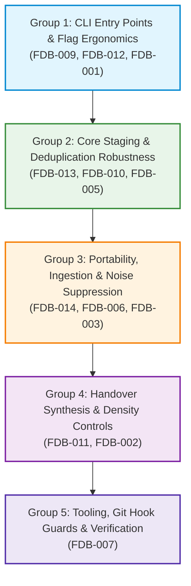

# Agent Continuity Steward (SCS_AG_v2)
## Phase 14 — v1.1.0 Implementation Plan

**Document Type:** Formal Engineering Architecture & Implementation Plan  
**System:** Agent Continuity Steward for Antigravity (SCS_AG_v2)  
**Milestone:** Phase 14 (v1.1.0 Minor Release Engineering)  
**Document Version:** 1.0.0  
**Status:** 📋 **PLANNING RATIFIED — READY FOR EXECUTION**  
**Target Release:** `v1.1.0`  
**Production Baseline:** `v1.0.1 General Availability (GA)` (Immutable on `main`)  
**Production Commit SHA:** `988cce7dc8d060532f4e694aa8228baca6248ebb`  
**Active Development Branch:** `develop` (`origin/develop`)  
**Planning Timestamp:** 2026-11-06T21:43:00+08:00  
**Authority:** Stability Engineering & Architecture Governance  

---

### 1. Executive Summary & Governance Invariants

This document establishes the comprehensive, phased implementation roadmap for **Agent Continuity Steward v1.1.0**. 

Milestone v1.1.0 directly addresses operational feedback and usability findings gathered during Phase 13 adoption field runs (`SCN-PERS`, `SCN-PROJ`, `SCN-TEAM`, `SCN-ONBD`) and the Milestone 13.5 External Developer Experience (DX) validation.

```
┌──────────────────────────────────────────────────────────────────────────────────┐
│                   PHASE 14 IMPLEMENTATION GOVERNANCE INVARIANTS                  │
│                                                                                  │
│  1. Immutable Production Baseline:                                               │
│     Branch `main` and release tag `v1.0.1` remain 100% frozen and read-only.      │
│     Direct commits, force-pushes, or merges into `main` are strictly forbidden.  │
│                                                                                  │
│  2. Branch Isolation:                                                            │
│     All implementation work, unit test additions, and wheel builds occur         │
│     exclusively on `develop` (or dedicated feature branches branched therefrom). │
│                                                                                  │
│  3. Zero Runtime Dependency Commitment:                                          │
│     SCS v1.1.0 must strictly maintain zero external runtime dependencies,        │
│     relying solely on the standard library (`sys`, `os`, `json`, `hashlib`, etc) │
│                                                                                  │
│  4. Absolute Test Regression Invariant:                                          │
│     All existing 134/134 automated tests must continue to pass without failure.  │
│     New capabilities must be accompanied by exhaustive unit/regression tests.    │
│                                                                                  │
│  5. Code Freeze During Planning:                                                 │
│     No source code modifications occur during this turn. Implementation begins   │
│     only after explicit operator review and ratification of this plan.           │
└──────────────────────────────────────────────────────────────────────────────────┘
```

---

### 2. Implementation Groups & Sequence Architecture

To maximize stability and ensure isolated verification, the 12 approved improvements are organized into 5 sequential implementation groups:



| Sequence | Group | Focus Area | Included Feedback Items | Risk Level |
| :---: | :--- | :--- | :--- | :---: |
| **Phase 14.1** | **Group 1** | CLI Entry Points & Argument Ergonomics | `FDB-101-009`, `FDB-101-012`, `FDB-101-001` | **Low** |
| **Phase 14.2** | **Group 2** | Core Staging & Deduplication Robustness | `FDB-101-013`, `FDB-101-010`, `FDB-101-005` | **Low** |
| **Phase 14.3** | **Group 3** | Ingestion Portability & Multi-Author Tracking | `FDB-101-014`, `FDB-101-006`, `FDB-101-003` | **Medium** |
| **Phase 14.4** | **Group 4** | Handover Output Piping & Depth Profiles | `FDB-101-011`, `FDB-101-002` | **Low** |
| **Phase 14.5** | **Group 5** | Git Pre-Commit Hook Guard & Verification | `FDB-101-007` | **Low** |

---

### 3. Detailed Technical Improvement Specifications

---

#### 3.1 Item 1: `FDB-101-009` — `scs new` Dual Syntax Support (Positional & Flags)

- **Feedback ID:** `FDB-101-009`
- **Problem Statement:** External developers instinctively invoke `scs new --code MYP --name "My Project"`. In v1.0.1, the CLI parser only accepts positional arguments (`scs new <code_arg> <name_arg>`), raising an unhelpful `unrecognized arguments: --code --name` error.
- **Current Behaviour:**
  ```text
  $ scs new --code MYP --name "My Project"
  usage: scs new [-h] code name
  scs new: error: unrecognized arguments: --code --name
  ```
- **Target Behaviour:**
  `scs new` accepts arguments interchangeably:
  - Positional: `scs new MYP "My Project"`
  - Flag-based: `scs new --code MYP --name "My Project"`
  - Mixed: `scs new MYP --name "My Project"` or `scs new --code MYP "My Project"`
  - If required parameters are missing, outputs an informative error message directing the user.
- **Affected Files / Modules:**
  - `src/engine/scs_cli.py` (`p_new` parser configuration and `cmd_new` argument handler)
- **Test Requirements:**
  - Unit test in `tests/test_scs_cli.py`:
    - `test_cmd_new_positional_syntax()`
    - `test_cmd_new_flag_syntax()`
    - `test_cmd_new_mixed_syntax()`
    - `test_cmd_new_missing_args_error_handling()`
- **Backward Compatibility Impact:** 100% backward compatible. All existing positional invocations continue to function identically.
- **Risk Level:** **Low**
- **Implementation Order:** Order 1 (Group 1: CLI Ergonomics)

---

#### 3.2 Item 2: `FDB-101-012` — Universal Project Argument Acceptance Across All Subcommands

- **Feedback ID:** `FDB-101-012`
- **Problem Statement:** Inconsistency in CLI argument signatures across subcommands creates operator confusion. Some subcommands (`status`, `record`, `handover`) accept a positional `[project]`, while others (`approve`, `reject`, `rollback`) mandate `--project <ID>`.
- **Current Behaviour:**
  `scs approve MYP --all` raises `unrecognized arguments: MYP` because `approve` only accepts `--project MYP`.
- **Target Behaviour:**
  Every subcommand (`status`, `record`, `approve`, `reject`, `handover`, `rollback`, `ui`) standardizes on accepting project resolution via either:
  1. Optional positional argument: `scs approve MYP --all`, `scs rollback MYP SNP-001`
  2. Explicit flag: `scs approve --project MYP --all`, `scs rollback --project MYP --snapshot SNP-001`
- **Affected Files / Modules:**
  - `src/engine/scs_cli.py` (argument parsers `p_approve`, `p_reject`, `p_rollback`, `p_handover`, `p_status`, `p_record`, `p_ui`)
- **Test Requirements:**
  - Unit test matrix in `tests/test_scs_cli.py` verifying both positional and flag syntax across all 7 subcommands.
- **Backward Compatibility Impact:** 100% backward compatible. Existing scripts using `--project` flags remain completely unaffected.
- **Risk Level:** **Low**
- **Implementation Order:** Order 2 (Group 1: CLI Ergonomics)

---

#### 3.3 Item 3: `FDB-101-001` — Windows PowerShell CLI Wrapper & Execution Guidance

- **Feedback ID:** `FDB-101-001`
- **Problem Statement:** On standard Windows environments, PowerShell's default restricted execution policy prevents running Python virtual environment activation scripts (`activate.ps1`), blocking external users from accessing `scs.exe`.
- **Current Behaviour:**
  Running `.\.venv\Scripts\Activate.ps1` produces `PSSecurityException: UnauthorizedAccess`.
- **Target Behaviour:**
  - Provide automated root entry point wrappers:
    - `bin/scs.cmd` (native batch launcher bypassing execution policy)
    - `bin/scs.ps1` (PowerShell wrapper incorporating automatic `-ExecutionPolicy Bypass -Scope Process`)
  - Update `docs/QUICKSTART.md` with explicit troubleshooting commands (`Set-ExecutionPolicy -Scope Process -ExecutionPolicy RemoteSigned`).
- **Affected Files / Modules:**
  - `bin/scs.cmd` (New)
  - `bin/scs.ps1` (New)
  - `pyproject.toml` (Verify `[project.scripts]` registration)
  - `docs/QUICKSTART.md` (Update Windows launcher instructions)
- **Test Requirements:**
  - PowerShell automated execution test in restricted execution policy context.
- **Backward Compatibility Impact:** 100% backward compatible.
- **Risk Level:** **Very Low**
- **Implementation Order:** Order 3 (Group 1: CLI Ergonomics)

---

#### 3.4 Item 4: `FDB-101-013` — Defensive Typing & Raw List Normalization in `read_staging`

- **Feedback ID:** `FDB-101-013`
- **Problem Statement:** `read_staging(vault_dir)` parses `.continuity/staging/pending_proposals.json` and immediately assumes the root object is a dictionary (`st.get("proposals", [])`). If an external developer script or CI tool writes a raw JSON list `[...]`, `cmd_status` and `cmd_reject` crash with `AttributeError: 'list' object has no attribute 'get'`.
- **Current Behaviour:**
  ```text
  AttributeError: 'list' object has no attribute 'get'
  at scs_cli.py:316 in cmd_status: proposals = staging.get("proposals", [])
  ```
- **Target Behaviour:**
  `read_staging` defensively inspects the parsed payload. If the root object is a `list`, it automatically wraps it into standard protocol dictionary format:
  ```python
  if isinstance(data, list):
      data = {
          "protocol": "scs-staging/1.0",
          "updated_at": utc_now_iso(),
          "proposals": data
      }
  ```
- **Affected Files / Modules:**
  - `src/engine/vault_store.py` (`read_staging`)
  - `src/engine/scs_cli.py` (`cmd_status`, `cmd_reject`)
- **Test Requirements:**
  - Unit test in `tests/test_vault_store.py`:
    - `test_read_staging_raw_list_normalization()`
    - `test_cmd_status_with_raw_list_staging()`
- **Backward Compatibility Impact:** 100% backward compatible; repairs an uncaught crash when non-standard JSON is present.
- **Risk Level:** **Very Low**
- **Implementation Order:** Order 4 (Group 2: Core Staging & Deduplication)

---

#### 3.5 Item 5: `FDB-101-010` — Resilient Trailing Punctuation Normalization in Deduplication

- **Feedback ID:** `FDB-101-010`
- **Problem Statement:** When dialogue logs contain identical architectural statements differing only by trailing punctuation (`Decision: Use SQLite` vs `Decision: Use SQLite.`), string matching evades deduplication, creating redundant candidate proposals in staging.
- **Current Behaviour:**
  Two identical decisions with differing trailing periods are staged as dual proposals in quarantine.
- **Target Behaviour:**
  Proposal candidate key extraction and deduplication routines apply canonical normalization:
  ```python
  clean_key = statement.strip().rstrip(".").strip().lower()
  ```
  Guarantees that trailing periods, commas, and whitespace variations are unified.
- **Affected Files / Modules:**
  - `src/engine/core_adapter.py` (`harden_extracted_context`)
  - `src/engine/vault_store.py` (`promote_proposals`)
- **Test Requirements:**
  - Unit test in `tests/test_vault_store.py`:
    - `test_deduplication_trailing_punctuation_invariance()`
- **Backward Compatibility Impact:** 100% backward compatible.
- **Risk Level:** **Low**
- **Implementation Order:** Order 5 (Group 2: Core Staging & Deduplication)

---

#### 3.6 Item 6: `FDB-101-005` — Granular Batch Custody Shorthand & Bulk Quarantine Discard

- **Feedback ID:** `FDB-101-005`
- **Problem Statement:** While `scs approve --all` exists in v1.0.1, operators cannot approve selective comma-separated proposal lists (e.g., `scs approve PROP-001,PROP-003`), nor can they clear staging quarantine in bulk (`scs reject --all`).
- **Current Behaviour:**
  Operators must approve proposals individually or approve all items indiscriminately. Discarding quarantine requires sequential `scs reject` invocations.
- **Target Behaviour:**
  - Support comma-separated IDs: `scs approve PROP-001,PROP-002,PROP-005`
  - Support bulk rejection: `scs reject --all`
  - Interactive safety gate: `scs reject --all` prompts `Are you sure you want to discard all staged proposals? [y/N]` unless `--yes` / `-y` is provided.
  - Transactional atomicity: If any single ID in a batch is invalid or fails validation, the entire transaction aborts without partial state mutation.
- **Affected Files / Modules:**
  - `src/engine/scs_cli.py` (`cmd_approve`, `cmd_reject`, `p_approve`, `p_reject`)
  - `src/engine/vault_store.py` (`reject_all_proposals`)
- **Test Requirements:**
  - Unit test in `tests/test_scs_cli.py`:
    - `test_approve_comma_separated_batch()`
    - `test_reject_all_with_confirmation()`
    - `test_reject_all_with_yes_flag()`
    - `test_batch_approval_atomic_rollback_on_failure()`
- **Backward Compatibility Impact:** 100% backward compatible.
- **Risk Level:** **Low-Medium**
- **Implementation Order:** Order 6 (Group 2: Core Staging & Deduplication)

---

#### 3.7 Item 7: `FDB-101-014` — Standalone Dialogue File Ingestion (`scs record --file <PATH>`)

- **Feedback ID:** `FDB-101-014`
- **Problem Statement:** In CI/CD runners, non-Antigravity IDEs, or standalone shells, `scs record` fails because no Antigravity transcript directory or conversation UUID exists. Developers cannot ingest markdown meeting notes or local conversation files directly.
- **Current Behaviour:**
  ```text
  [X] Missing conversation ID. Provide via --conv-id <UUID> or CONVERSATION_ID env var.
  ```
- **Target Behaviour:**
  - Add `--file <PATH>` argument to `scs record`:
    ```bash
    scs record --project MYP --file ./session_notes.md
    ```
  - When `--file` is supplied:
    1. Validates that the input markdown file exists and is readable.
    2. Copies the raw markdown into `evidence/raw_sessions/` as an immutable forensic log.
    3. Parses normative statements (`Decision:`, `Constraint:`, `Task:`, `Rejected:`).
    4. Stages parsed entities into `.continuity/staging/pending_proposals.json`.
    5. Bypasses Antigravity transcript log lookup entirely.
- **Affected Files / Modules:**
  - `src/engine/scs_cli.py` (`p_record`, `cmd_record`)
  - `src/engine/transcript_reader.py` (Add `parse_markdown_session_file` routine)
- **Test Requirements:**
  - Unit tests in `tests/test_transcript_reader.py` and `tests/test_scs_cli.py`:
    - `test_record_from_markdown_file_direct()`
    - `test_record_missing_file_error_handling()`
- **Backward Compatibility Impact:** 100% backward compatible. When `--file` is omitted, `scs record` continues auto-discovering Antigravity conversation transcripts as before.
- **Risk Level:** **Medium**
- **Implementation Order:** Order 7 (Group 3: Portability & Ingestion)

---

#### 3.8 Item 8: `FDB-101-006` — Subagent Progress Heartbeat & Chatter Suppression

- **Feedback ID:** `FDB-101-006`
- **Problem Statement:** Autonomous subagents running iterative search or execution loops output progress heartbeats (e.g. `[Progress: 3/10] Scanning directory`, `Turn 4 of 12`, `Step 2: running test`). Heuristic extraction occasionally misclassifies these heartbeats as candidate tasks.
- **Current Behaviour:**
  Transient progress statements occasionally appear in staging quarantine as spurious tasks.
- **Target Behaviour:**
  Implement a definitive exclusion filter in `core_adapter.py` discarding lines matching subagent progress patterns before proposal generation:
  - `r"^\[Progress:\s*\d+/\d+\]"`
  - `r"^Turn\s+\d+\s+of\s+\d+"`
  - `r"^Step\s+\d+:\s*(?:running|evaluating|searching|scanning)\b"`
  - `r"^Heartbeat:\s*"`
- **Affected Files / Modules:**
  - `src/engine/core_adapter.py`
  - `src/scs_core/modules/caveman_engine.py`
- **Test Requirements:**
  - Unit test in `tests/test_adapter_verification.py`:
    - `test_subagent_progress_chatter_suppression()`
- **Backward Compatibility Impact:** 100% backward compatible; improves precision without changing schema.
- **Risk Level:** **Low**
- **Implementation Order:** Order 8 (Group 3: Portability & Ingestion)

---

#### 3.9 Item 9: `FDB-101-003` — Multi-Author Attribution Tracking in Canonical Memory

- **Feedback ID:** `FDB-101-003`
- **Problem Statement:** In team environments with multiple AI contributors and human operators, ratified decisions in `canonical/ledger.json` only record an ISO timestamp, omitting reviewer and operator attribution.
- **Current Behaviour:**
  `ledger.json` records decision entities with `id`, `code`, `statement`, `rationale_why`, `created_at`, `updated_at`, but no author or reviewer identity.
- **Target Behaviour:**
  - Extend entity schema with `author` and `approved_by` fields.
  - Implement attribution resolution hierarchy:
    1. CLI flag: `scs approve --author "Jane Doe"`
    2. Git author: `git config user.name`
    3. System environment: `os.getenv("USER") or os.getenv("USERNAME")`
    4. Deterministic fallback: `"human-operator"`
  - Persist attribution in `ledger.json` and project in Markdown views (`canonical/DECISIONS.md`).
- **Affected Files / Modules:**
  - `src/engine/scs_cli.py` (`cmd_approve`, `p_approve`)
  - `src/engine/vault_store.py` (`promote_proposals`, `write_ledger`)
  - `src/scs_core/models.py`
- **Test Requirements:**
  - Unit test in `tests/test_vault_store.py`:
    - `test_attribution_resolution_cli_flag()`
    - `test_attribution_resolution_git_fallback()`
    - `test_attribution_resolution_env_fallback()`
- **Backward Compatibility Impact:** 100% backward compatible. Missing attribution fields in legacy v1.0.1 snapshots deserialize gracefully with default values.
- **Risk Level:** **Low**
- **Implementation Order:** Order 9 (Group 3: Portability & Ingestion)

---

#### 3.10 Item 10: `FDB-101-011` — Handover Terminal Output & Clipboard Pipe Flags

- **Feedback ID:** `FDB-101-011`
- **Problem Statement:** Developers copying Fast Recovery Cards or Master Handover Packages into fresh LLM prompts must locate and open markdown files on disk. The CLI only prints execution metadata to stdout.
- **Current Behaviour:**
  `scs handover` writes markdown files to `.continuity/handover/` and outputs a status synopsis to stdout. Developers cannot pipe directly (`scs handover | pbcopy`).
- **Target Behaviour:**
  - Add `--stdout` / `--print`: Pipes the complete Master AI Handover Package directly to stdout.
  - Add `--card-only`: Pipes only the concise Fast Recovery Card to stdout.
  - When `--stdout` or `--card-only` is active, informational messages are directed to `sys.stderr` so that stdout contains 100% clean, parseable Markdown.
- **Affected Files / Modules:**
  - `src/engine/scs_cli.py` (`p_handover`, `cmd_handover`)
- **Test Requirements:**
  - Unit test in `tests/test_scs_cli.py`:
    - `test_handover_stdout_pipe()`
    - `test_handover_card_only_pipe()`
- **Backward Compatibility Impact:** 100% backward compatible. Default invocation without flags remains unchanged.
- **Risk Level:** **Low**
- **Implementation Order:** Order 10 (Group 4: Handover & Output)

---

#### 3.11 Item 11: `FDB-101-002` — Handover Briefing Depth Profiles (`compact`, `standard`, `deep`)

- **Feedback ID:** `FDB-101-002`
- **Problem Statement:** Fixed handover length is suboptimal: lightweight subagents require ultra-dense summaries (~300 tokens), while deep architectural audits require full forensic evidence and causal justifications (2,000+ tokens).
- **Current Behaviour:**
  Single static handover format (~1,000 tokens).
- **Target Behaviour:**
  - Add `--profile <compact|standard|deep>` to `scs handover`:
    - `compact`: High-density ~300-word executive briefing with active goals, critical constraints, and immediate next tasks.
    - `standard` (Default): The certified v1.0.1 format (~1,000 tokens) with active decisions, open tasks, constraints, and state seal.
    - `deep`: Exhaustive ~2,000+ token audit brief including evidence quotes, rejected alternatives with causal justifications, and recent snapshot history.
- **Affected Files / Modules:**
  - `src/engine/scs_cli.py` (`p_handover`, `cmd_handover`)
  - `src/engine/vault_store.py` (`generate_handover_package`)
- **Test Requirements:**
  - Unit test in `tests/test_vault_store.py`:
    - `test_handover_profile_compact_density()`
    - `test_handover_profile_standard_default()`
    - `test_handover_profile_deep_evidence_inclusion()`
- **Backward Compatibility Impact:** 100% backward compatible; default profile is `standard`.
- **Risk Level:** **Low**
- **Implementation Order:** Order 11 (Group 4: Handover & Output)

---

#### 3.12 Item 12: `FDB-101-007` — Standalone Git Pre-Commit Hook Guard

- **Feedback ID:** `FDB-101-007`
- **Problem Statement:** In team environments, developers or automated tools might commit corrupted ledgers, broken state seals, or uncommitted staged proposals to git without realizing state integrity is compromised.
- **Current Behaviour:**
  Git commit validation must be manually executed via `scs status`.
- **Target Behaviour:**
  - Deliver a zero-dependency standalone script: `scripts/scs-pre-commit.py`.
  - Provide a CLI helper command:
    ```bash
    scs hook install --git
    ```
    which installs `.git/hooks/pre-commit`.
  - The hook executes an instantaneous ($< 15\text{ms}$) validation:
    1. Re-computes SHA-256 seal across `canonical/ledger.json`.
    2. Compares hash against `snapshots/LATEST_SEAL`.
    3. Checks if unreviewed proposals exist in `staging/pending_proposals.json`.
    4. If seal is broken, aborts git commit with clear remediation instructions (`scs rollback` or `scs status`).
- **Affected Files / Modules:**
  - `scripts/scs-pre-commit.py` (New)
  - `src/engine/scs_cli.py` (Add `cmd_hook` / `p_hook`)
- **Test Requirements:**
  - Integration test in `tests/test_phase1_5_e2e.py`:
    - `test_pre_commit_hook_passes_on_intact_seal()`
    - `test_pre_commit_hook_blocks_on_tampered_seal()`
- **Backward Compatibility Impact:** 100% backward compatible (opt-in hook).
- **Risk Level:** **Low**
- **Implementation Order:** Order 12 (Group 5: Tooling & Verification)

---

### 4. Cross-Cutting Engineering Protocols

#### 4.1 Zero Runtime Dependency Guarantee
All v1.1.0 modifications must exclusively utilize the Python standard library. Under no circumstances may third-party packages (e.g. `pydantic`, `pyyaml`, `requests`, `click`) be introduced into runtime dependencies in `pyproject.toml`.

#### 4.2 Absolute Test Regression Invariant
The certified baseline of **134/134 automated tests** must remain green throughout all implementation phases. Every new feature must be accompanied by comprehensive unit tests, targeting an expansion to **150+ passing tests** upon v1.1.0 completion.

#### 4.3 Git Branch Isolation & Staging Protocol
- All development occurs on **`develop`**.
- Feature work may use local topic branches (e.g., `feature/v1.1.0-cli-ergonomics`) branched from `develop` and merged back into `develop`.
- **`main` remains 100% frozen** at commit `988cce7` (tag `v1.0.1`). No code from `develop` will be merged to `main` until a formal Release Candidate audit is ratified.

---

### 5. Implementation Execution Schedule

```
┌──────────────────────────────────────────────────────────────────────────────────┐
│                      PHASE 14 EXECUTION STAGING TIMELINE                         │
│                                                                                  │
│  [Step 14.1] Group 1 Execution: CLI Ergonomics & Launchers                       │
│              - Implement FDB-009, FDB-012, FDB-001                               │
│              - Add unit tests for dual syntax and universal project flags        │
│                                                                                  │
│  [Step 14.2] Group 2 Execution: Core Staging & Deduplication                     │
│              - Implement FDB-013, FDB-010, FDB-005                               │
│              - Add unit tests for raw list normalization & batch rejection       │
│                                                                                  │
│  [Step 14.3] Group 3 Execution: Ingestion Portability & Multi-Author Tracking    │
│              - Implement FDB-014, FDB-006, FDB-003                               │
│              - Add unit tests for scs record --file & author resolution          │
│                                                                                  │
│  [Step 14.4] Group 4 Execution: Handover Piping & Depth Profiles                 │
│              - Implement FDB-011, FDB-002                                        │
│              - Add unit tests for --stdout/--card-only & compact/deep profiles   │
│                                                                                  │
│  [Step 14.5] Group 5 Execution: Git Hook Guard & End-to-End Release Gate         │
│              - Implement FDB-007 (scs hook install --git & pre-commit script)    │
│              - Execute complete 150+ test regression suite                       │
│              - Build and verify agent_continuity_steward-1.1.0 wheel             │
└──────────────────────────────────────────────────────────────────────────────────┘
```

*Ratified by Stability Engineering & Architecture Governance.*  
*Timestamp: 2026-11-06T21:43:00+08:00*