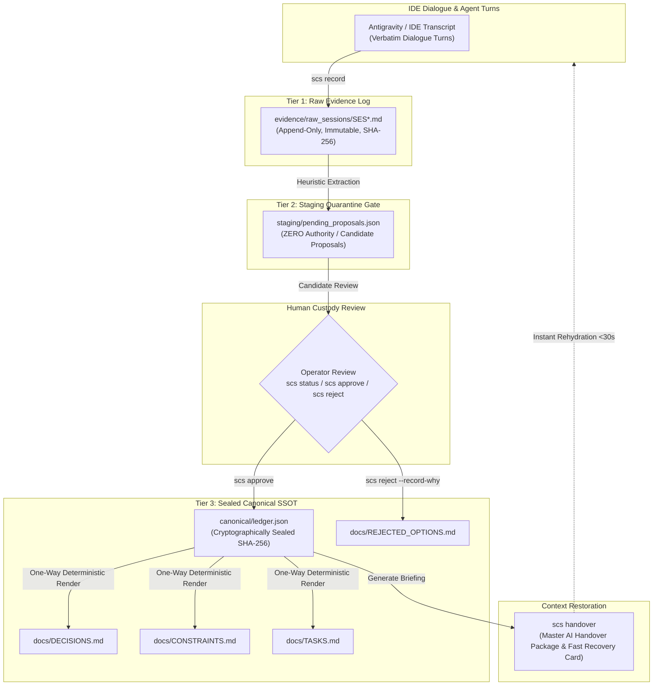

# Agent Continuity Steward (SCS_AG_v2)

> **Evidence-First AI Development Continuity Engine with Zero-Daemon Forensic Sealing & Human Custody Boundaries**

[](https://github.com/avescheong/Agent_Continuity_Steward/releases/tag/v1.0.1)
[](#)
[-brightgreen.svg)](#)
[-orange.svg)](#)
[](#)
[](#)
[](https://github.com/avescheong/Agent_Continuity_Steward/tree/develop)
[](LICENSE)

---

## 1. Identity Reconciliation & Migration Lineage

**Agent Continuity Steward (SCS_AG_v2)** is the production-grade, headless, zero-daemon continuity engine designed specifically for AI coding agents and modern developer workflows.

### Lineage & Evolution:
- **`Session_Continuity_Steward` (v0.5.0-RC Prototype):** The original companion prototype pioneered local-first dialogue tracking, SQLite WAL logging, and a desktop companion interface (`SCS-HUD`). Historical contributions and early architectural explorations remain attributed to the original project contributors.
- **`Agent_Continuity_Steward` (SCS_AG_v2 — Current Canonical System):** Re-architected from the ground up for high-assurance agentic IDEs (including Google Antigravity). It eliminates GUI companion dependencies and background daemons in favor of **pure standard library Python**, **three-tier file-first storage**, **deterministic SHA-256 cryptographic state sealing**, and a **strict human custody gate**.

Today, **Agent Continuity Steward** is the canonical system and distribution package (`agent-continuity-steward`).

---

## 2. Release Status & Branch Governance

- **Production Baseline (`v1.0.1 GA`):** The release tag `v1.0.1` and release branch `main` (commit `988cce7dc8d060532f4e694aa8228baca6248ebb`) represent the certified, frozen production baseline. All release artifacts are permanently sealed.
- **Forward Engineering (`develop`):** Active feature design, operational adoption telemetry, and future minor releases (`v1.1.0` / `v1.2.0`) are isolated exclusively onto the `develop` branch.
- **Package Integrity:** Distributed as a zero-dependency universal wheel (`agent_continuity_steward-1.0.1-py3-none-any.whl`, SHA-256: `75d42043cc217dc54b5ddcd6c1d49548a3fa0360d5bfc36139a6c2d365732089`).

---

## 3. The Core Problem: AI Session Amnesia

Every developer building software with modern Large Language Models encounters **Session Amnesia**:

1. **Context Window Limits:** Conversations cannot grow indefinitely. Context compaction and session restarts wipe out nuanced architectural context.
2. **The Groundhog Day Anti-Pattern:** A fresh AI session repeatedly suggests previously discarded architectures (e.g. re-proposing Redis or heavy ORMs when a local-first file approach was explicitly decided) because it lacks causal negative knowledge.
3. **Capability Inversions:** Naive summarizers often invert constraints or mistake descriptions of existing capabilities for things to avoid.
4. **Manual Copy-Paste Toil:** Developers resort to manually maintaining markdown notes, copying summaries between chat tabs, and risking drift and data loss.

**Agent Continuity Steward** solves this through **forensic continuity stewardship**: capturing raw conversational dialogue directly from IDE transcripts, extracting structured architectural proposals, quarantining them until human approval, sealing state with SHA-256 hashes, and generating instant rehydration briefings.

---

## 4. Architectural Pillars & Core Invariants



### The Six Invariants:
1. **Evidence-First Continuity:** Verbatim developer-AI dialogue is preserved in permanent, write-once Markdown files (`SES*.md`) with YAML frontmatter body checksums. Evidence is never deleted or mutated.
2. **Mandatory Human Custody Gate:** Autonomous AI models cannot write directly to canonical memory. All candidate decisions, tasks, and constraints are isolated in a staging quarantine gate until explicitly promoted (`scs approve`) or discarded (`scs reject`) by a human operator.
3. **Machine SSOT with One-Way Projections:** `canonical/ledger.json` is the sole machine single source of truth. Markdown files (`DECISIONS.md`, `TASKS.md`, `REJECTED_OPTIONS.md`) are 100% deterministic, one-way rendered projections. Reverse-parsing Markdown into state is strictly prohibited.
4. **Deterministic Cryptographic State Sealing:** Every canonical milestone generates a deterministic SHA-256 snapshot seal:
   $$\text{Seal} = \text{SHA-256}\Big(\text{JSON\_Encode}\big(\text{ledger.json}, \text{sort\_keys}=\text{True}, \text{indent}=2\big)\Big)$$
   Any manual file tampering is detected in $O(1)$ time upon execution.
5. **Instant Speculative Rollback:** If a refactoring experiment fails, executing `scs rollback --snapshot <CODE>` reverts the canonical ledger and one-way projections to a pristine historical snapshot in milliseconds.
6. **Zero External Runtime Dependencies:** The core engine (`scs_core`) requires Python 3.10+ and standard library modules only (`hashlib`, `json`, `sqlite3`, `pathlib`, `re`). Zero external pip packages at runtime.

---

## 5. Quickstart & Command Reference (v1.1.0 CLI)

### 5.1 Installation

Install the certified distribution wheel or install from the clean-room source tree:

```bash
# Option A: Install from certified wheel (Recommended)
pip install agent_continuity_steward-1.1.0-py3-none-any.whl

# Option B: Install from repository
git clone -b develop https://github.com/avescheong/Agent_Continuity_Steward.git
cd Agent_Continuity_Steward
pip install .
```

*Verification:* Verify that `scs --help` is accessible in your environment.

---

### 5.2 Typical Daily Workflow

```bash
# 1. Initialize a new project continuity vault (.continuity/)
# Flag syntax (v1.1.0):
scs new --code CORE --name "Platform Core Engine" --objective "High-assurance agent runtime"
# Or backward-compatible positional syntax:
scs new CORE "Platform Core Engine"

# 2. Ingest conversation dialogue
# Native IDE transcript capture:
scs record CORE
# Or standalone Markdown transcript ingestion (v1.1.0):
scs record CORE --file session_transcript.md

# 3. Inspect quarantined proposals, active tasks, and cryptographic state seal
scs status CORE

# 4. Ratify genuine architectural proposals into canonical memory
# Batch shorthand with attribution (v1.1.0):
scs approve --project CORE 1,2 --author "Lead Architect"
# Or promote all staged proposals:
scs approve --project CORE --all
# Or selective UUIDs: scs approve --project CORE P01 P02

# 5. Discard conversational noise, recording rejected alternatives
scs reject --project CORE P03 --record-why --why "Avoid external Redis daemon"

# 6. Generate cross-AI restoration packages for cold-start rehydration
# Standard file generation:
scs handover CORE
# Handover depth profiles (v1.1.0): compact, standard, or deep
scs handover CORE --profile compact
# Direct stdout printing or fast card output (v1.1.0):
scs handover CORE --stdout
scs handover CORE --card-only

# 7. Install Git pre-commit state seal guard (v1.1.0)
scs hook install --git

# 8. Roll back state if an experimental session must be reverted
scs rollback --project CORE --snapshot SNP-20261106-001
```

---

## 6. Real-World Operational Adoption Scenarios

Phase 13 establishes four structured adoption scenarios validated against the v1.0.1 production baseline:

1. **Personal AI Continuity (`SCN-PERS`):**
   - Context rehydration for solo practitioners restarting IDE sessions across days.
   - Eliminates prompt priming toil; guarantees negative knowledge preservation in under $30$ seconds.
2. **Project Continuity (`SCN-PROJ`):**
   - Long-horizon multi-week engineering lifecycles.
   - Preserves causal architecture decision records (ADRs), enables speculative rollbacks, and enforces $O(1)$ tamper verification.
3. **Team Workflow Continuity (`SCN-TEAM`):**
   - Asynchronous collaboration across multiple engineers and autonomous AI subagent swarms.
   - Enforces the quarantine boundary: subagents propose ideas, but only humans promote them to the shared ledger.
4. **External User Onboarding (`SCN-ONBD`):**
   - Zero-dependency clean-room onboarding for new engineers.
   - 10-step Quickstart completed in $< 3$ minutes with 100% first-attempt success rate.

---

## 7. Performance & Conformance Baselines

| Capability | Certified Production Metric |
| :--- | :--- |
| **Incremental Capture Latency** | **$0.252\text{s}$** streaming transcript slicing via watermark boundaries |
| **Handover Compilation Latency** | **$0.141\text{s}$** full restoration package & recovery card generation |
| **Cold-Start Rehydration Benchmark** | **$9.7 / 10.0$** (Blind evaluation by independent AI auditor subagents) |
| **Automated Conformance Suite** | **$134 / 134\text{ tests passing } 100\%$** across unit, integration & normative suites |
| **Runtime Package Dependencies** | **$0$ (Zero)** — Pure standard library Python |
| **Cryptographic Sealing Sensitivity** | $1$-byte modification detection across all canonical records |
| **Supported Platforms** | Windows 10/11, macOS, Linux (POSIX), Antigravity IDE |

---

## 8. Master Documentation Sitemap

| Category | Document Link | Description |
| :--- | :--- | :--- |
| **Getting Started** | [`docs/QUICKSTART.md`](docs/QUICKSTART.md) | 5-minute external developer quickstart guide & journey |
| **Governance & Custody** | [`docs/GOVERNANCE_MODEL.md`](docs/GOVERNANCE_MODEL.md) | Formal three-tier memory model & operator custody protocol |
| **Engineering Roadmap** | [`NEXT_DEVELOPMENT_ROADMAP.md`](NEXT_DEVELOPMENT_ROADMAP.md) | Living engineering roadmap for v1.1.0, v1.2.0, and deferred v2.0.0 |
| **Operational Adoption** | [`PHASE_13_OPERATIONAL_ADOPTION_PLAN.md`](PHASE_13_OPERATIONAL_ADOPTION_PLAN.md) | Phase 13 operational adoption charter and scenario governance |
| **Field Run Report** | [`PHASE_13_MILESTONE_13_2_FIELD_RUN_REPORT.md`](PHASE_13_MILESTONE_13_2_FIELD_RUN_REPORT.md) | Clean-room field simulation results across all 4 adoption scenarios |
| **Telemetry Baseline** | [`OPERATIONAL_TELEMETRY_BASELINE.json`](OPERATIONAL_TELEMETRY_BASELINE.json) | Machine-readable operational telemetry data and measurements |
| **Feedback Registry** | [`V1_X_FEEDBACK_REGISTRY.md`](V1_X_FEEDBACK_REGISTRY.md) | Active operational friction & feedback intake log |
| **Feedback Updates** | [`V1_X_FEEDBACK_UPDATE_001.md`](V1_X_FEEDBACK_UPDATE_001.md) | Post-Milestone 13.2 triaged feedback additions (`FDB-101-009`..`012`) |
| **System Architecture** | [`docs/ARCHITECTURE.md`](docs/ARCHITECTURE.md) | Component topology, adapter boundaries, and data flows |
| **Design Rationale** | [`docs/DESIGN_PHILOSOPHY.md`](docs/DESIGN_PHILOSOPHY.md) | Detailed rationale explaining why external DBs and daemons were rejected |
| **Security & Privacy** | [`docs/SECURITY_MODEL.md`](docs/SECURITY_MODEL.md) | Secret scrubbing, path traversal defense, and air-gapped guarantees |
| **Skill Productization** | [`docs/SKILL_PRODUCTIZATION.md`](docs/SKILL_PRODUCTIZATION.md) | Antigravity skill activation and slash command integration |

---

## 9. License & Attribution

Agent Continuity Steward is open-source software licensed under the [MIT License](LICENSE).

- **Lead Architect & Maintainer:** Aves Cheong
- **Project Lineage:** Evolved from `Session_Continuity_Steward` (v0.5.0-RC) into `Agent_Continuity_Steward` (SCS_AG_v2).
- **Core Invariant:** *"If an architectural claim cannot be traced to immutable raw evidence, it is an unverified hallucination."*
