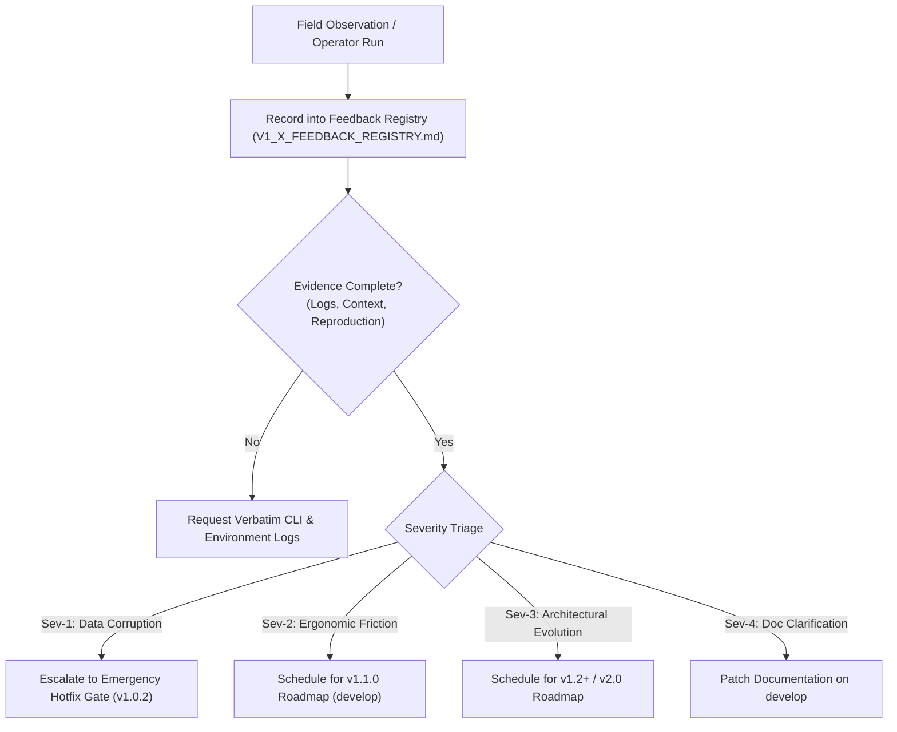

# Agent Continuity Steward (SCS_AG_v2)
## v1.x Operational Feedback & Telemetry Registry

**Document Type:** Continuous Operational Telemetry & Feedback Registry  
**System:** Agent Continuity Steward for Antigravity (SCS_AG_v2)  
**Document Version:** 1.0.1 GA / Phase 13 Operational Intake  
**Registry Status:** 🟢 **ACTIVE OPERATIONAL INTAKE**  
**Production Baseline:** `v1.0.1 General Availability (GA)` (Commit `988cce7dc8d060532f4e694aa8228baca6248ebb` — Immutable)  
**Target Development Branch:** `develop` (`origin/develop`)  
**Operating Policy:** Non-invasive collection without altering GA production baseline  
**Authority:** Stability Engineering & Architecture Governance  

---

### 1. Registry Architecture & Governance

This registry captures real-world operational feedback, ergonomic friction, edge-case observations, and workflow telemetry gathered across the four Phase 13 operational adoption scenarios:
1. **Personal AI Continuity** (`SCN-PERS`)
2. **Project Continuity** (`SCN-PROJ`)
3. **Team Workflow Continuity** (`SCN-TEAM`)
4. **External User Onboarding** (`SCN-ONBD`)

#### Core Governance Rules:
- **Baseline Protection:** No feedback item recorded in this registry authorizes direct or unvetted commits to the immutable `main` release branch.
- **Evidence-First Requirement:** Every entry must include verbatim reproduction steps, CLI output transcripts, or exact operator quotes.
- **Traceable Triage:** Every item is formally triaged against target milestones (`v1.1.0`, `v1.2.0`, `v2.0.0`, or `DOCS_ONLY`).

---

### 2. Operational Feedback Master Intake Matrix (Items 001–015)

| Feedback ID | Date | Scenario | Subsystem | Sev | Summary | Target Milestone | Status | Source Record |
| :--- | :---: | :---: | :---: | :---: | :--- | :---: | :---: | :---: |
| **`FDB-101-001`** | 2026-11-06 | `SCN-ONBD` | `COMP-CLI` | **P2** | Windows PowerShell execution policy guidance when launching CLI wrappers | `v1.1.0` / Docs | `TRIAGED` | Baseline |
| **`FDB-101-002`** | 2026-11-06 | `SCN-PERS` | `COMP-SKILL` | **P2** | Handover briefing token density control (`--profile compact\|deep\|full`) | `v1.1.0` | `TRIAGED` | Baseline |
| **`FDB-101-003`** | 2026-11-06 | `SCN-TEAM` | `COMP-VAULT` | **P2** | Multi-author attribution tracking (`approved_by`, `operator_id`) in canonical ledger | `v1.1.0` | `TRIAGED` | Baseline |
| **`FDB-101-004`** | 2026-11-06 | `SCN-PROJ` | `COMP-VAULT` | **P3** | Hierarchical discovery precedence between centralized (`~/.scs/`) and workspace (`.scs_vault/`) | `v1.2.0` | `TRIAGED` | Baseline |
| **`FDB-101-005`** | 2026-11-06 | `SCN-PERS` | `COMP-CLI` | **P2** | Batch approval & rejection shorthand syntax (`scs approve --all`, `scs approve 1,2,3`) | `v1.1.0` | `TRIAGED` | Baseline |
| **`FDB-101-006`** | 2026-11-06 | `SCN-TEAM` | `COMP-EXTR` | **P2** | Subagent chatter heuristic noise suppression during parallel search loops | `v1.1.0` | `TRIAGED` | Baseline |
| **`FDB-101-007`** | 2026-11-06 | `SCN-PROJ` | `COMP-VAULT` | **P3** | Standalone Git pre-commit hook script verifying SHA-256 state seal integrity before commit | `v1.1.0` | `TRIAGED` | Baseline |
| **`FDB-101-008`** | 2026-11-06 | `SCN-ONBD` | `COMP-DOCS` | **P4** | Cross-platform shell syntax examples in Quickstart (PowerShell vs POSIX `export`/`set`) | `v1.0.2-docs` | `RESOLVED_DOCS` | Baseline |
| **`FDB-101-009`** | 2026-11-06 | `SCN-ONBD` | `COMP-CLI` | **P2** | `scs new` rejects `--code` and `--name` flag syntax, requiring positional arguments only | `v1.1.0` | `TRIAGED` | [`Update #001`](V1_X_FEEDBACK_UPDATE_001.md) |
| **`FDB-101-010`** | 2026-11-06 | `SCN-TEAM` | `COMP-EXTR` | **P2** | Decision deduplication evades match when dialogue contains trailing period (`.` vs bare) | `v1.1.0` | `TRIAGED` | [`Update #001`](V1_X_FEEDBACK_UPDATE_001.md) |
| **`FDB-101-011`** | 2026-11-06 | `SCN-PERS` | `COMP-DOCS` | **P2** | CLI stdout displays execution synopsis while full 10k-character recovery package is in file | `v1.1.0` / Docs | `TRIAGED` | [`Update #001`](V1_X_FEEDBACK_UPDATE_001.md) |
| **`FDB-101-012`** | 2026-11-06 | `SCN-CLI` | `COMP-CLI` | **P2** | Positional vs `--project` flag inconsistency across subcommands (`status`/`record` vs `approve`) | `v1.1.0` | `TRIAGED` | [`Update #001`](V1_X_FEEDBACK_UPDATE_001.md) |
| **`FDB-101-013`** | 2026-11-06 | `SCN-ONBD` | `COMP-VAULT` | **P2** | `read_staging` crashes on raw JSON list with `AttributeError: 'list' object has no attribute 'get'` | `v1.1.0` | `TRIAGED` | [`Update #002`](V1_X_FEEDBACK_UPDATE_002.md) |
| **`FDB-101-014`** | 2026-11-06 | `SCN-ONBD` | `COMP-CLI` | **P2** | `scs record` outside Antigravity requires UUID; lacks `--file <PATH>` direct file ingestion | `v1.1.0` | `TRIAGED` | [`Update #002`](V1_X_FEEDBACK_UPDATE_002.md) |
| **`FDB-101-015`** | 2026-11-06 | `SCN-PERS` | `COMP-CLI` | **P3** | Lack of dedicated snapshot exploration CLI commands (`scs snapshot list` / `inspect`) | `v1.2.0` | `TRIAGED` | [`Update #002`](V1_X_FEEDBACK_UPDATE_002.md) |

---

### 3. Summary of Field Updates & Dossier Links

Detailed evidence, verbatim operator transcripts, root cause analyses, and proposed engineering solutions for all feedback items are cataloged in:
- **Baseline Feedback Dossiers (001–008):** Ingested during Phase 13 Milestone 13.1 foundation.
- **Feedback Update #001 (009–012):** [`V1_X_FEEDBACK_UPDATE_001.md`](V1_X_FEEDBACK_UPDATE_001.md) — Ingested following Phase 13 Milestone 13.2 clean-room adoption simulations.
- **Feedback Update #002 (013–015):** [`V1_X_FEEDBACK_UPDATE_002.md`](V1_X_FEEDBACK_UPDATE_002.md) — Ingested following Phase 13 Milestone 13.5 external developer experience validation.

---

### 4. Consolidated Triage Status

- **Critical Regressions (Sev-1):** **0** — Production baseline `v1.0.1 GA` is 100% stable, secure, and unmodified.
- **Ergonomic Enhancements (Sev-2):** **11 items** scheduled for Milestone `v1.1.0` on `develop`.
- **Architectural Expansions (Sev-3):** **3 items** scheduled for Milestone `v1.2.0` / `v2.0.0`.
- **Documentation Polish (Sev-4):** **1 item** resolved in `docs/QUICKSTART.md`.

---

### 5. Attestation & Governance

This registry serves as the authoritative evidentiary record for v1.x operational feedback. All contributions conform to the evidence-first governance model of the Agent Continuity Steward project.

*Ratified by Stability Engineering & Architecture Governance.*  
*Timestamp: 2026-11-06T21:20:00+08:00*
